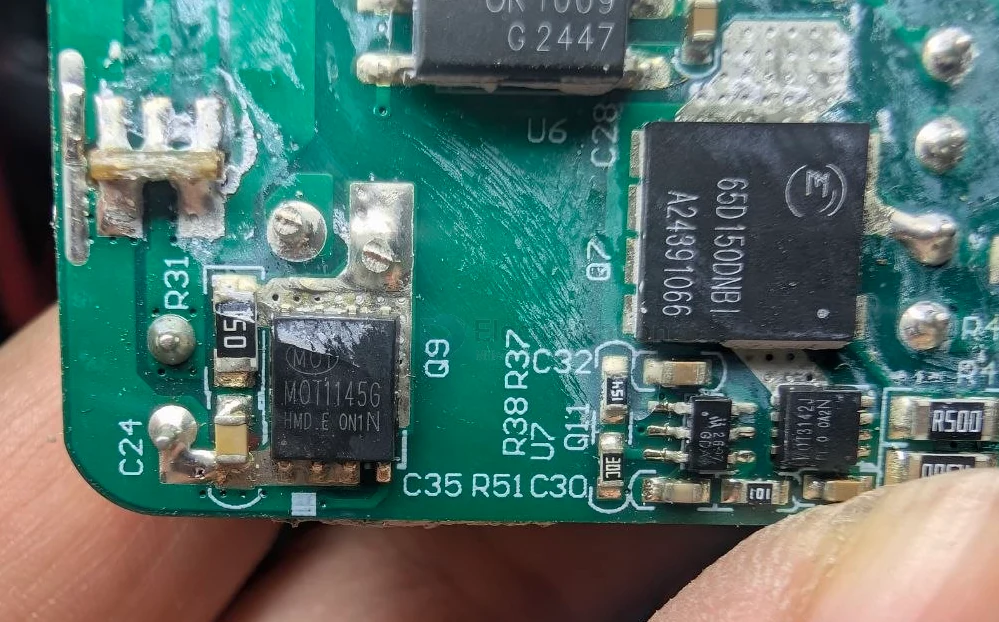

# MOT1145-dat

- [[inmark-dat]] - [[MOT1145-dat]] - [[mosfet-dat]] - [[PDFN-dat]] == 75W 100V 90A 4.5mΩ@10V 1 N-channel N-Channel PDFN-8(5x6) Single FETs, MOSFETs 

The MOT1145G is a `100V, 90A` N-channel enhancement-mode MOSFET manufactured by Guangdong Inmark Electronics Co., Ltd. (MOT Semiconductor). Housed in a compact 8-PDFN (5x6) surface-mount package, it is designed for high-efficiency switching applications like synchronous rectification in GaN fast chargers.

65D150DNBI

A24391066

## build 

- [[MOT1145-dat]] - [[MK91808-dat]] - [[acdc-dat]]

## ref 