# insta360-go2-camera-dat

- [[insta360-go2-charger-dat]] - [[insta360-go2-dat]] - [[insta360-dat]] - [[insta360-go2-camera-dat]]

## build details 

overview 

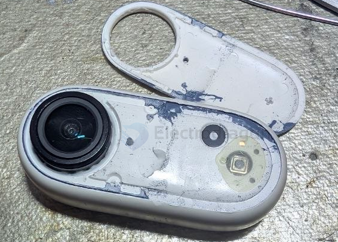

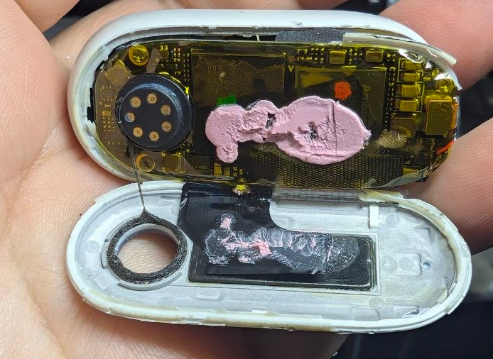

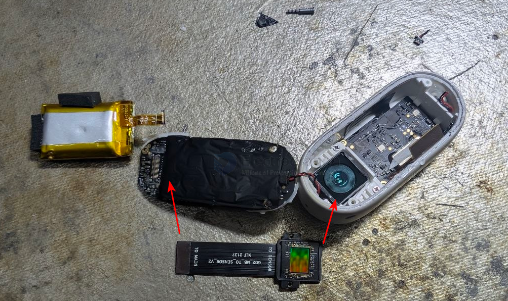

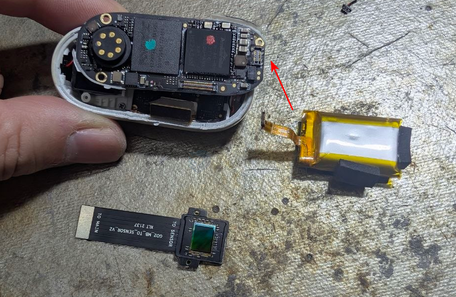

- [[glue-dat]] - [[fix-dat]] - [[insta360-go2-camera-dat]]

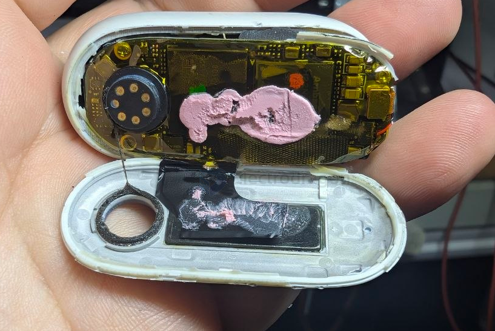

- [[assembly-dat]] - [[magnetic-dat]] - [[insta360-go2-camera-dat]]

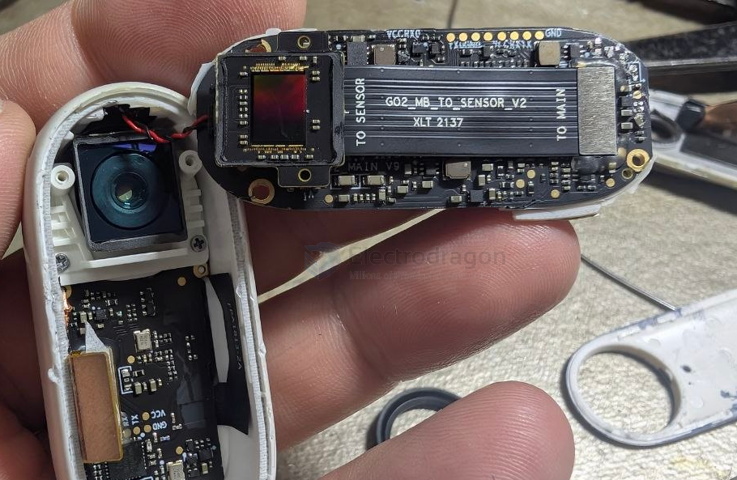

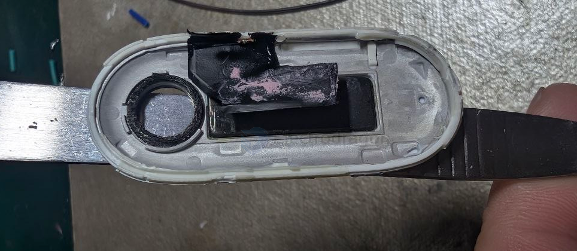

- [[battery-li-dat]]

middle main PCB 

2017RA **2071BA**

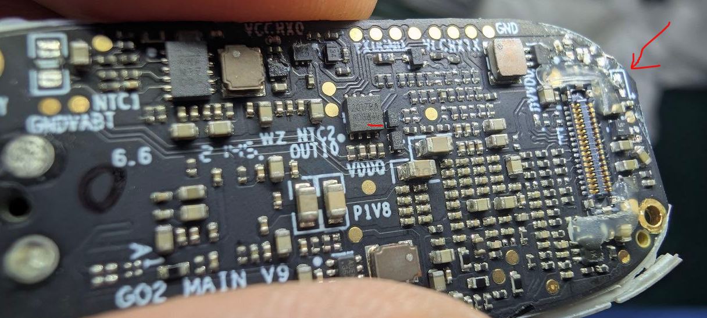

ANA N17 004  AUEN

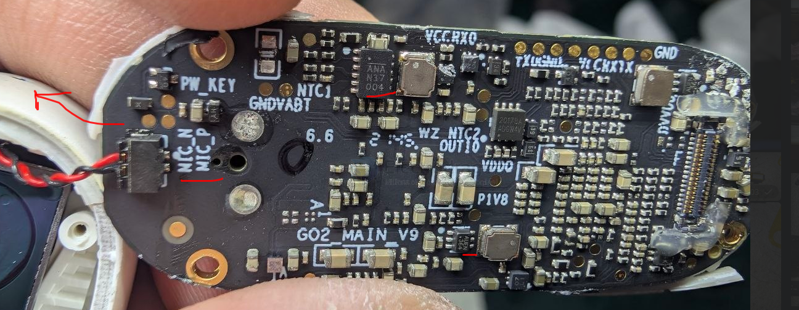

bad disassembly by piler

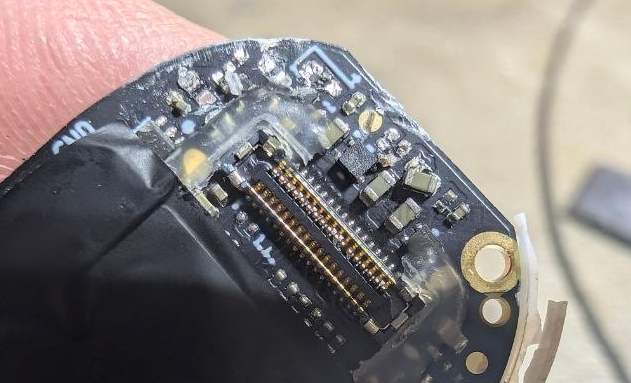

bottom PCB 

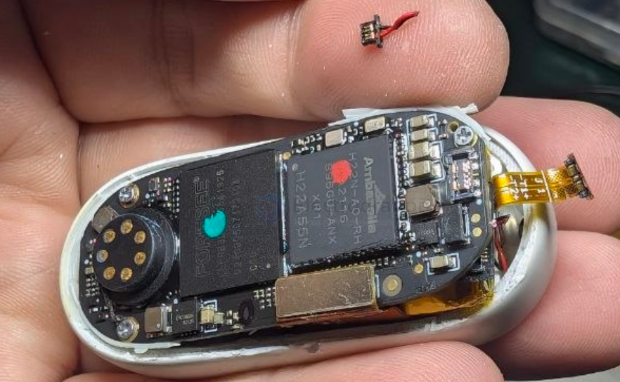

sensor PCB 

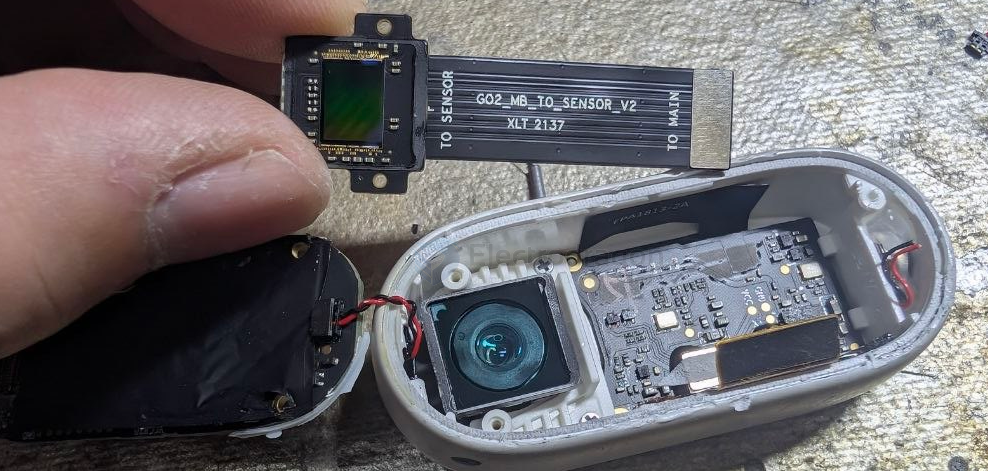

1469D

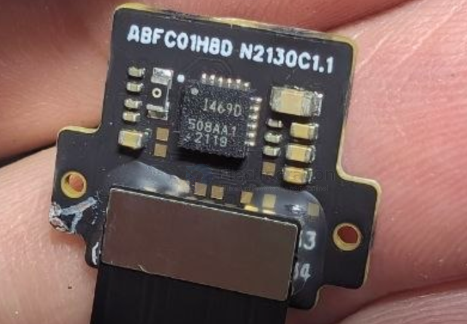

- [[foresee-dat]] - [[FEPRB3216-dat]] - [[ambarella-dat]] - [[H22N-A0-HR-dat]] - [[insta360-go2-camera-dat]]

- [[flash-NAND-dat]] - [[sensor-camera-chip-dat]] - [[sensor-camera-dat]] - [[ambarella-dat]] - [[H22N-A0-HR-dat]] 

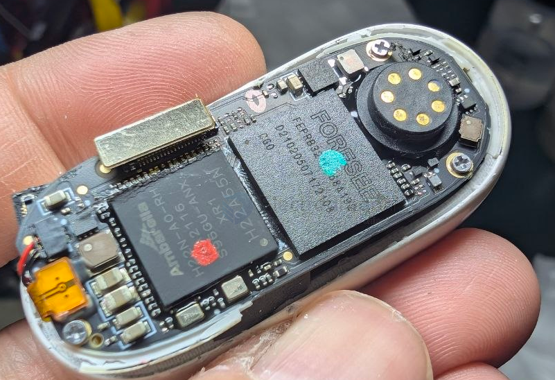

## ref 

