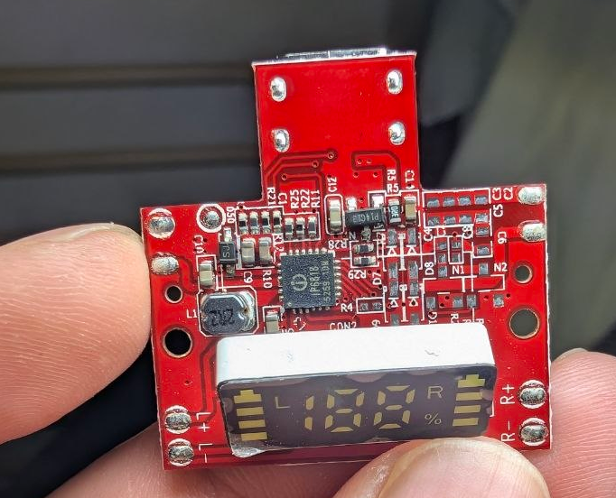

# IP6818-dat

- [[IP6818-dat]] - [[power-bank-dat]] - [[ismartware-dat]]

- [[bluetooth-dat]] - [[bt-audio-dat]] - [[TWS-dat]] - [[earphone-charing-box-dat]]

TWS Bluetooth Earphone Charging Box SOC
integrated withQi wireless power reciever

IP6818 is a multi-functional power management
SOC for total solution on TWS Bluetooth Earphone
Charging Box. It integrates with Qi wireless power
receiver, 5V-boost converter, lithium battery charging
management and battery level indicators.
IP6818 is highly integrated with abundant
functions, which makes the total solution size
minimized and BOM costed down.
The synchronous 5V-boost system of IP6818
provides rated 300mA output current with conversion
efficiency up to 93%. DC-DC converter operates at
1.5MHz, and can support low-cost inductors and
capacitors.
IP6818’s linear charging system supplies max
500mA charging current. With the change of IC
temperature and input voltage, IP6818 can
automatically adjust the charging current.
IP6818 can detects the TWS earphone
plug-in/plug-out in the Chargering Box independently.
While the earphone is put in the Chargering Box, it
enters the discharging mode automaticaly. When the
earphone is fully charged, the Chargering Box
automatically enters the sleep state, and the standby
current can be reduced to 20uA. The earphone’s
charge-end current can be Flexible and customizable,
such as 4mA or 8mA.
IP6818 can support 1/2/3/4 LED battery indicator,
The built-in 12bits ADC can accurately calculate the
Chargering Box’s battery capacity.
IP6818 is packaged with QFN24(4*4*0.75mm).

## build 

## ref 

