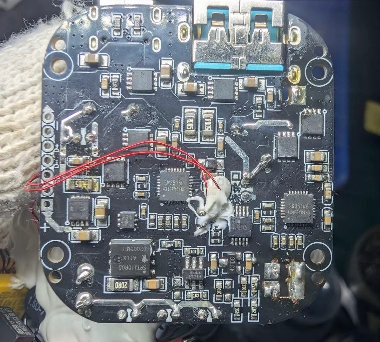
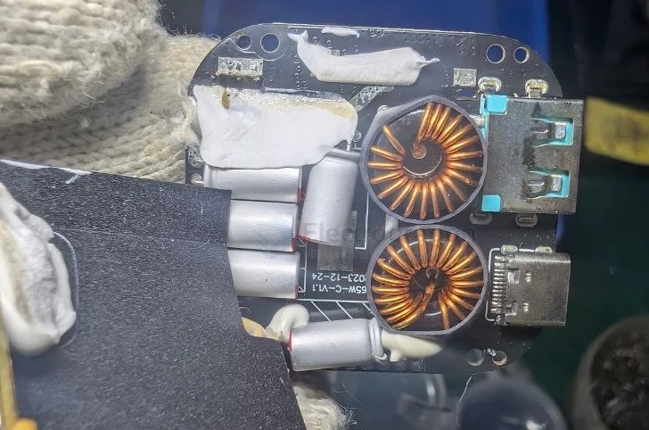
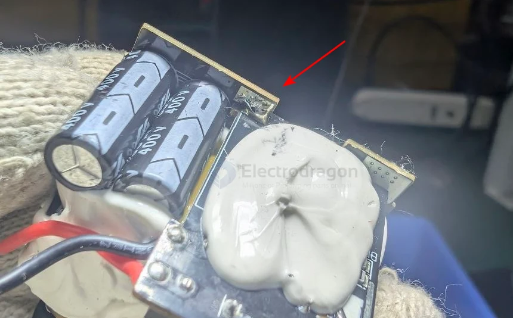

# SW3516-dat

- [[SW3516-dat]] - [[SW3518-dat]] - [[ismartware-dat]] == 100W - [[power-bank-dat]]

## build 

SPTJ 10R05 - SPTJ10R05
- [[SPTJ10R05-dat]] == mosfet ?? - [[mosfet-dat]]

923a 

431DG 

IP2133 - [[IP2133-dat]] - [[injoinic-dat]] - [[emarker-dat]] - [[SW3516-dat]]

PTI04N03LA 

- [[FMD-dat]] - [[FT61EC-dat]] - [[MCU-dat]]

## ref 

