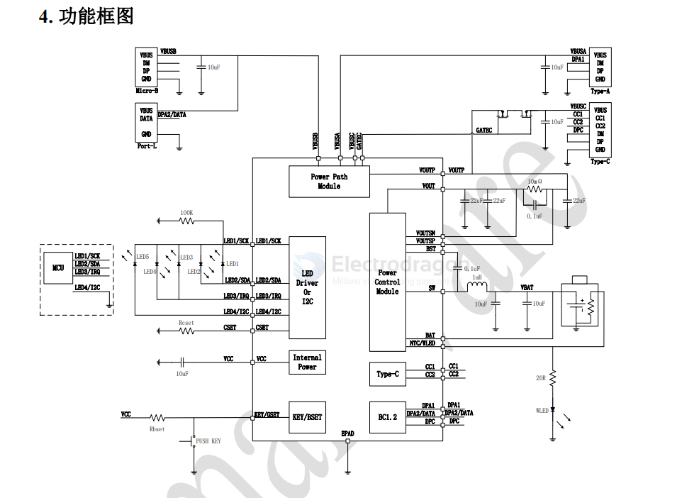
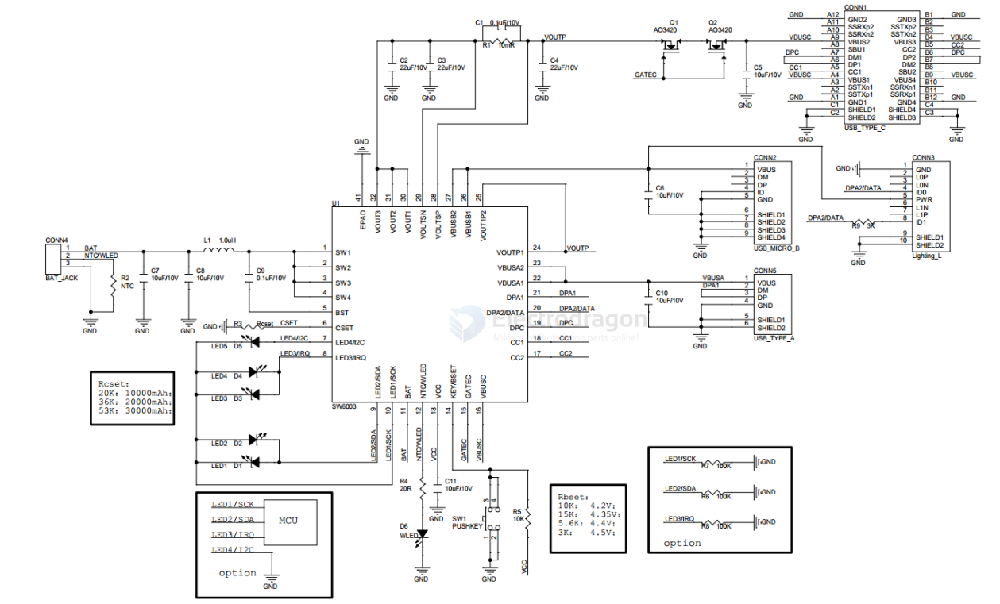
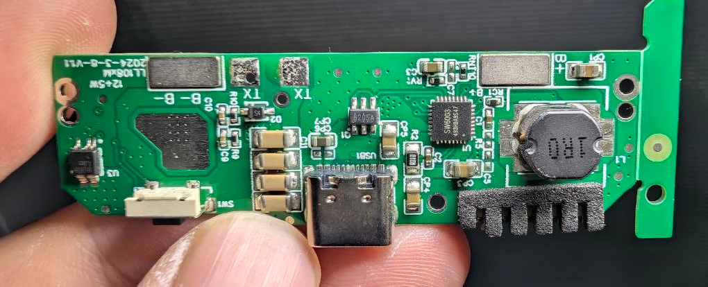

# SW6003-dat

- [[SW6003-dat]] - [[ismartware-dat]]

5V/2.4A 单芯片 Type-C 移动电源解决方案

SW6003 是一款高集成度的 Type-C 移动电源专用多合一芯片，支持 A+B+C+L 或 A+A+B+C 四口， 其集成了 2.4A 高效率开关充电， 2.4A 高效同步升压输出， 电量计量， LED 灯显示以及相应的控制管 理逻辑。 外围只需少量的器件， 即可组成完整的高性能 Type-C 移动电源解决方案。

## app 

移动电源 - [[power-bank-dat]]

其他电池供电设备 - [[battery-powered-device-dat]]

## sch 

## build 

build 1 

- [[IP6805-dat]] - [[injoinic-dat]] - [[power-wireless-dat]]

## ref 