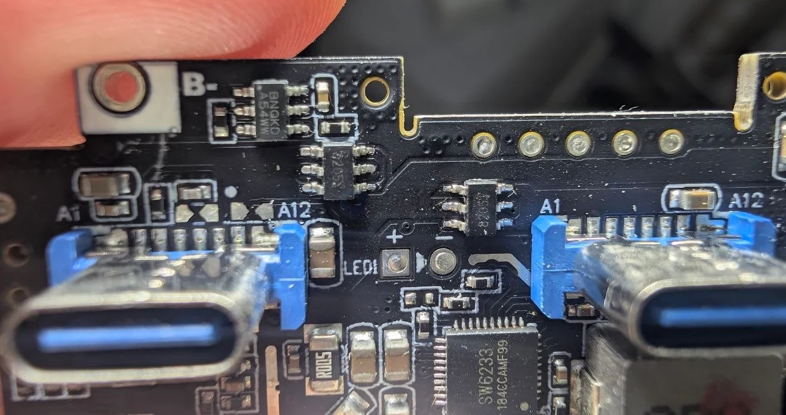
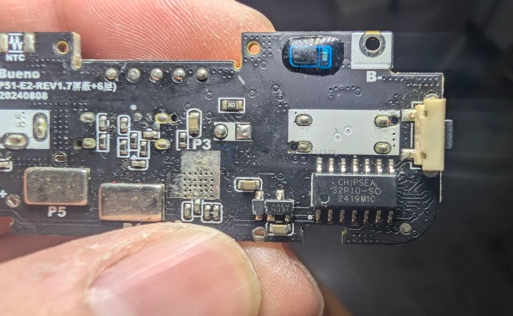
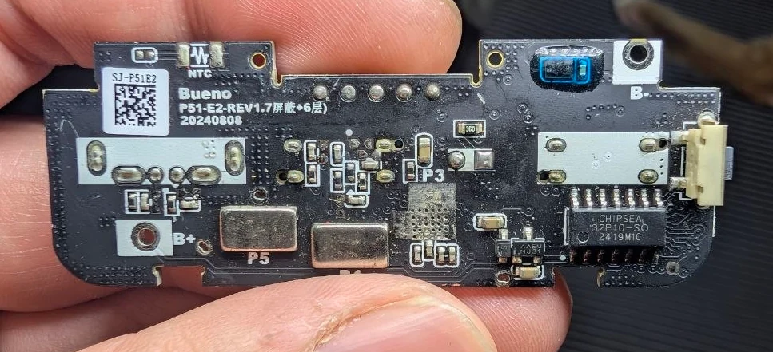
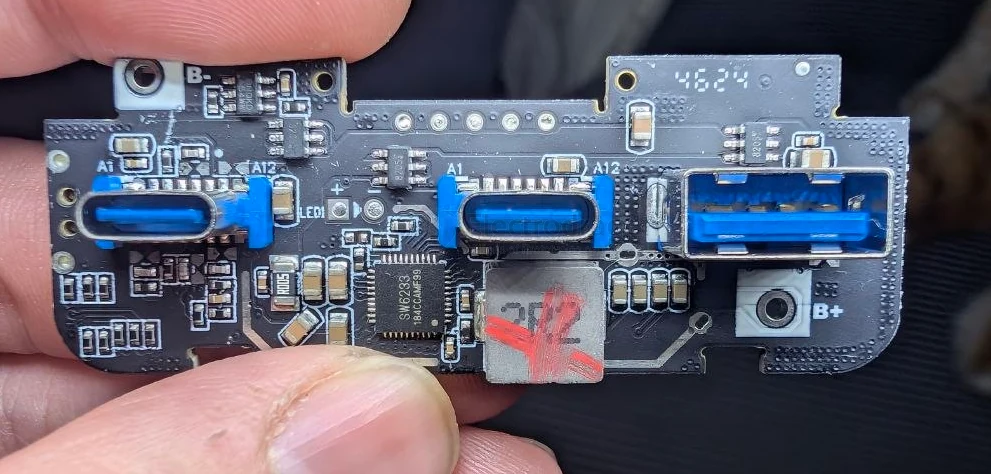

# SW6233-dat

- [[SW6233-dat]] - [[SW6236-dat]] - [[ismartware-dat]] - [[power-bank-dat]]

## build 

- [[chipsea-dat]] - [[CSU32P10-dat]] - [[SW6233-dat]] - [[power-bank-dat]]

- 3x [[8205-dat]] - [[SW6233-dat]]

BNQKD 

AAEM 

## ref 

