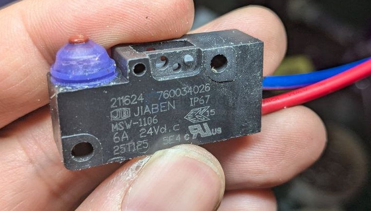

# jiaben-dat

- [[jiaben-dat]] - [[swtich-micro-dat]] - [[swtich-dat]]

6A 24VDC 

MSW-1106 most commonly refers to the JIABEN MSW-1106 sealed microswitch (rated IP67, 6A 24V DC, 25T125, 5E4).

Key Specifications (JIABEN MSW-1106)

• Ingress Protection: IP67 (dust-tight and water-resistant)
• Electrical Rating: 6A at 24V DC
• Ratings / Markings: 25T125, 5E4 (temperature and endurance markings)
• Configuration: Available in variants with pre-attached lead wires (such as red/black or red/blue) and normally open (NO) setups depending on the specific assembly.

## ref 

