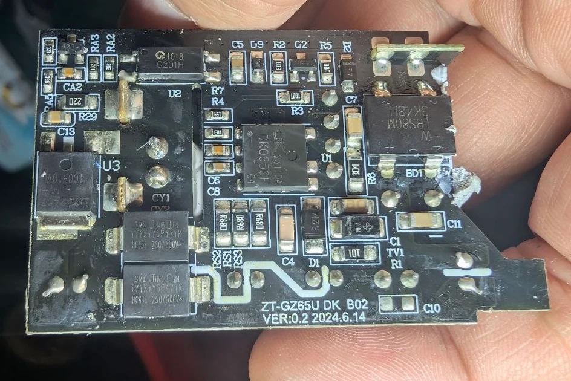
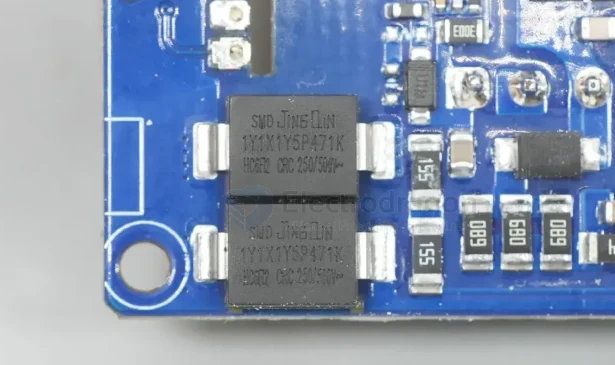
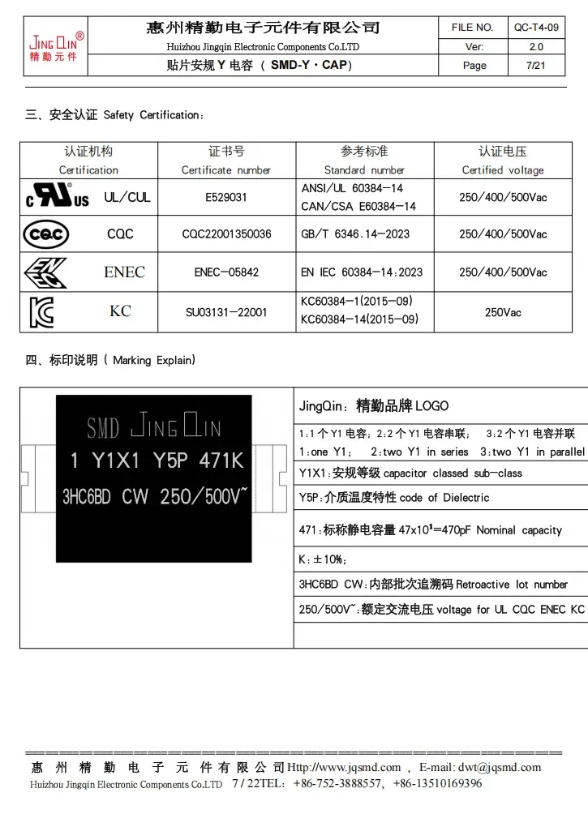

# 1Y1X1Y5P471K-dat

- [[jingqin-dat]] - [[1Y1X1Y5P471K-dat]] - [[capacitor-y-dat]]

## build 

build 2 

build 1 

两颗精勤 1Y1X1Y5P471K 贴片 Y 电容跨接在初次级之间，与 OR1008 光耦配合，在传递隔离反馈信号的同时，构成初次级之间的安规隔离屏障。

## specs 

## ref 