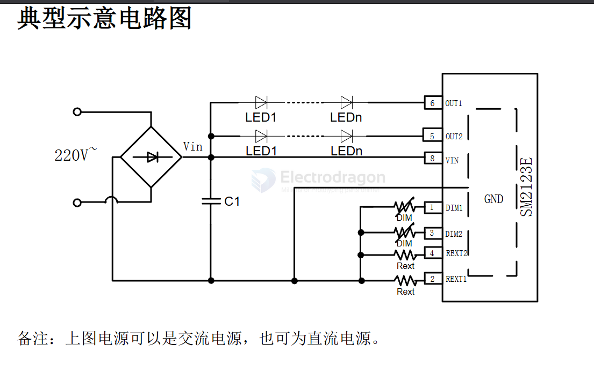

# SM2123E-dat

- [[linkage-dat]] - [[SM2123E-dat]] - [[led-driver-dat]] 

SM2123E 双通道可调光 LED 恒流驱动芯片

The SM2123E is a double-channel adjustable (dimmable) LED constant current drive IC (integrated circuit) manufactured by Linkage Goston Electronics (LINKAGE).

Key Characteristics & Applications

• Function: Dual-channel LED constant current driver with dimming/adjustment capabilities.
• Package Type: Typically available in an ESOP8/SOP-style surface-mount package.
• Primary Use: Designed for LED lighting applications, solid-state lighting circuits, and constant-current strip or fixture drivers.

特点
 本司专利的恒流控制技术；
a) OUT 端口输出电流外置可调，范
围 5mA~60mA；
b) 芯片间输出电流偏差< ± 4%；
 具有模拟/数字调光功能；
 具有过热保护功能；
 芯片可与 LED 共用 PCB 板；
 芯片应用系统无 EMI 问题；
 线路简单、成本低廉；
 封装形式：ESOP8

## SCH

STD 

## ref 