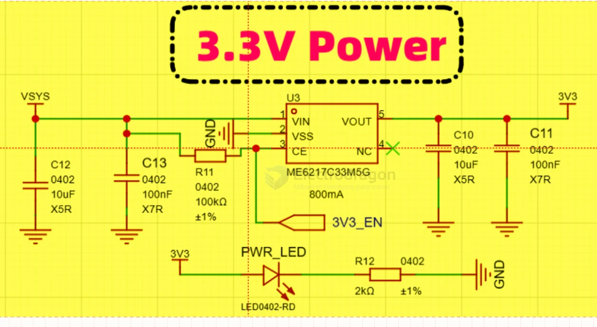
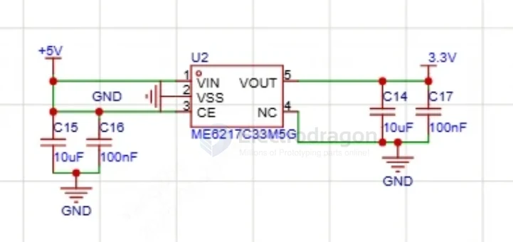

# ME6217-dat

- [[ME6217-dat]] - [[microne-dat]] - [[LDO-dat]] - [[ESP32-HDK-dat]]

- [[microne-dat]] - [[LDO-dat]] - [[ME6217-dat]] == [[SOT23-5-dat]] == 800 mA - [[RTL8213-dat]]

High Output Current LDO Regulator , High PSRR , Low Dropout, ME6207 Series

General Description

The ME6217 Series is a positive voltage regulator
with a low dropout voltage,high output voltage
accuracy,and low crrent consumption developed based
on CMOS technology.
 A built-in low on-resistance transistor provides a
low dropout voltage and large output current, a built-in
overcurrent protector prevents the load current from
exceeding the current capacitance of the output
transistor. An ON/OFF circuit ensures a long battery
life. Compared with the voltage regulators using the
conventional CMOS process, a larger variety of
capacitors are available, including small ceramic
capacitors. 

Features

 Maximum Output Current: 800 mA（VIN≥VOUT(T)+1.0V）
 Dropout Voltage: 100mV@ IOUT =300mA, VOUT =5.0V
 Operating Voltage Range: 2V～6.5V
 Output Voltage：1.5V~5.6V ，selectable in 0.1V steps
 Highly Accuracy: ±1％
 Low Current Consumption:
- During Operation: 100uA（TYP.）
- During Shutdown:0.1uA（TYP.）
 High Ripple Rejection: 65dB@1KHz (ME6217C50)
 Line Regulation: 0.05％（TYP.）
 Thermal Shutdown Protection：160℃
 Small Packages: `SOT-89-5,SOT23-5，SOT89-3`

Typical Application

 Power supply for DVD and CD-ROM drives
 Power supply for personal communication device
 Power supply for battery-powered devices
 Power supply for note PCs 

## build 

build 2 

build 1 

MCU部分采用ME6217C33M5G LDO供电，上游电源来自IP5306升压输出的5V 2.4A，足矣驱动ESP32C3。

## ref 