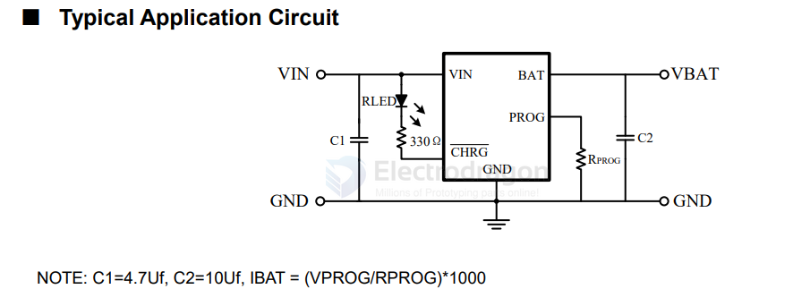

# XT4052-dat

- [[battery-charger-1s-dat]] - [[XT4052-dat]] - [[natlinear-dat]] - [[TP4052-dat]]

Standalone Linear Li-Ion Battery Charger with Thermal Regulation

The marking 3KAC in a SOT23-5 package most commonly corresponds to the XT4052K421MR-G (or XT4052), a single-cell lithium battery charging management IC.

Key Specifications (XT4052K421MR-G / 3KAC)

• Function: Linear lithium-ion / lithium-polymer battery charging IC with thermal management
• Package: SOT23-5 (5-pin surface-mount package)
• Input Supply Voltage: 4.25V to 6.5V
• Output Voltage (Float Voltage): 4.2V
• Max Output / Charging Current: Up to 800mA
• Common Alternative Silk Screen Codes: 3KAF, 3KAL, 3KA*

■ Features
 Programmable Charge Current Up to 300mA
 No MOSFET, Sense Resistor or Blocking Diode
Required
 Complete Linear Charger in ThinSOT Package for
single Cell Lithium-Ion Batteries
 Constant-Current/Constant-Voltage Operation with
Thermal Regulation to Maximize Charge Rate
Without Risk of Overheating
 Charges Single Cell Li-Ion Batteries Directly from
USB Port
 Preset 4.2V Charge Voltage with 1% Accuracy
 Charge Current Monitor Output for Gas Gauging
 Automatic Recharge
 Charge Status Output Pin
 C/10 Charge Termination
 25A Supply Current in Shutdown
 2.9V Trickle Charge Threshold (XT4052)
 Soft-Start Limits Inrush Current
 Battery reversed protection
 7KV ESD(HBM) capability
 Available in 5-Lead SOT-23 and SOT-89 Package

## ref 