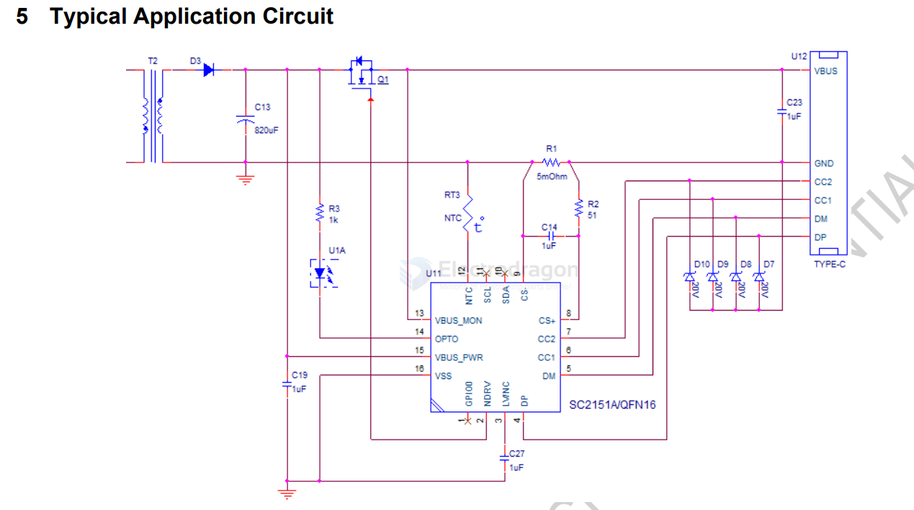
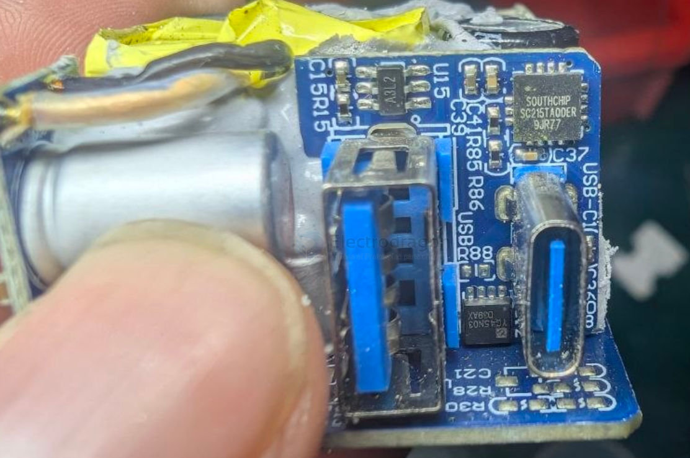

# SC215-dat

- [[southchip-dat]] - [[SC215-dat]] - [[fast-charge-protocols-dat]]

The Southchip SC215TAODER refers to the SC215TA, a Type-C/PD and DPDM fast charge controller integrated circuit manufactured by Southchip Semiconductor. The "ODER" suffix typically denotes specific ordering, packaging, or tape-and-reel specifications (such as QFN-16).

SC2151A is a Type-C / PD and DPDM fast charge controller, with internal feedback compensation integrated. It complies with
the latest Type-C and PD 3.0 standards supports the most popular high voltage fast charge protocols with DPDM interface. It
targets for the wall adapters and power strips applications.
SC2151A minimizes external components by integrating USB PD baseband PHY, Type-C detection, VBUS discharging path,
VCONN supply, programmable feedback compensation, voltage and current sense, 10bit high performance ADC, dual 10bit
DACs, NMOS gate driver, I2C interface and protection circuits. It is embedded 32-bit high performance micro-controller with
24K-Bytes OTP and 2K-Byte RAM, which provides cost effective solutions to many applications.
SC2151A supports various protection mechanisms including over voltage protection, under voltage protection, over current
protection, short circuit protection, over temperature protection, DPDM over voltage protection, CC over voltage protection,
VCONN over voltage, over current and short protection, so to effectively ensure stable and reliable operation of system. 

2 Features
• USB Type-C
➢ Support Type-C DFP protocols
➢ Configurable resistors RP
• USB Power Delivery
➢ Support DFP / UFP / DRP USB PD 3.0
➢ Hardware BMC transmitter and receiver
➢ Full feature physical layer
➢ Hardware CRC
➢ Hardware reset
➢ Integrate PD 3.0 protocol engine
➢ Integrate VCONN and support SOP’ for e-marker
• DPDM Fast Charging Interface
➢ Integrate firmware controlled DPDM interface
➢ Support Apple charging, BC1.2, DCP, HVDCP, FC,
AFC, FCP, SCP, VOOC, UART, I2C and other
proprietary charging protocols
• Power
➢ Wide operation range: 3.3V to 22V (26V tolerant)
➢ Integrate programmable feedback compensation.
• MCU Subsystem
➢ Integrated 32bit high performance MCU core
➢ 24-KB OTP and 2-KB RAM
➢ Support I2C interface and multiple I/Os
➢ Support sleep mode, min IQ <=100uA
• Analog Block
➢ Dual DACs for voltage regulation
➢ 10-bit ADC to monitor the voltage / current / other
signals
➢ Integrated current sense amplifier
➢ Integrated NMOS gate driver
➢ Integrated VBUS discharging paths at both sides of
isolation MOS
➢ Integrated temperature sense module
o Protections
➢ On chip OVP, DPDM OVP, CC OVP
➢ VBUS to CC / DPDM short protection
➢ GND to CC / DPDM short protection
o Package
➢ 16-pin QFN, 4mm x 4mm x 0.75mm
3 Applications
• Wall adapters
• Power strips

## SCH 

## build 

- [[mosfet-dat]] - [[YG45N03-dat]] - [[huayi-dat]] - [[southchip-dat]] - [[SC215-dat]] - [[fast-charge-protocols-dat]]

## ref 