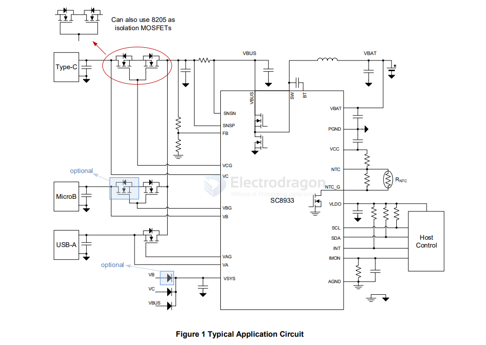
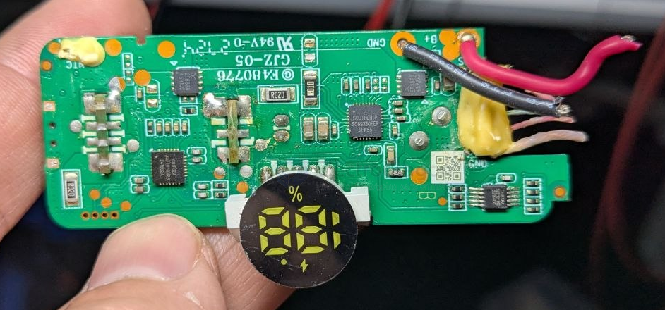
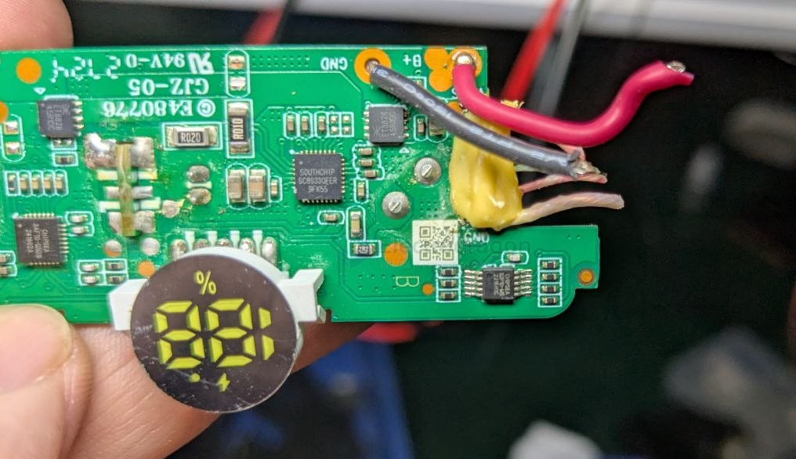
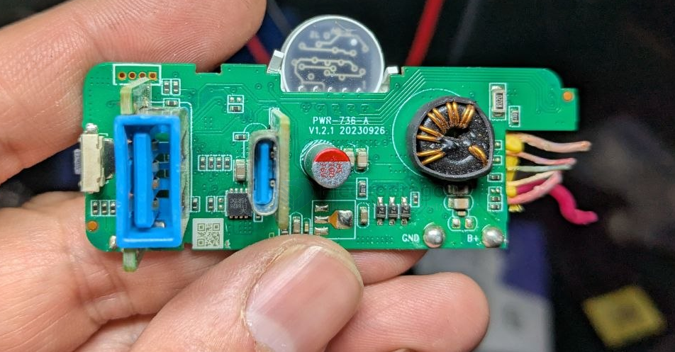

# SC8933-dat

- [[SC8933-dat]] - [[power-bank-dat]] - [[charger-USB-dat]] - [[southchip-dat]]

- [[DCDC-down-dat]] 

SC8933 High Efficiency, Synchronous, Bi-directional Buck Charger Converter with Integrated MOSFETs and I2C Interface

集成MOSFETs和I2C控制接口的高效率同步降压快速充电升压放电双向转换
器

SC8933是一颗同步降压充电控制器，同时具有反向升压放电功能。SC8933内部集成了两颗功率管（6mΩ及12mΩ Rdson），适用于单节或多节电池并联应用，并提供最大24W输出（12V/A）。

充电模式时，SC8933通过将高于电池电压的输入电压降压，从而高效地完成电池充电。SC8913支持完善的充电循环管理包括：涓流充电、恒流充电和恒压充电。

放电模式时，SC8933可以高效率地反向升压放电，输入/出电压最高可达14V。SC8933集成I2C接口，因此用户可以很方便地选择充电/放电模式，并通过I2C编程设置输入限流值、输出限流值和输出电压，最大限度简化系统设计，减少BOM。集成3路USB NOMS隔离管驱动并提供相应的电流检测，以及插入（包括负载接入/移除，充电器接/入移除）功能。集成了线损补偿，充放电环路状态标志方便系统设计；创新的监控输出脚，可选输出系统各节点电流/电压信号。支持IDEL模式以及开漏结构的NTC控制设计，极大的降低了待机功耗。

SC8933支持完善的保护，包括欠压锁定、过压保护、过流保护、短路警示和过温保护等功能，从而保证各种异常情况下的安全。

SC8933提供超小型32脚的4X4 QFN封装。

## 2 Features
-  Charging management, including trickle charging, CC charging, CV charging and charging termination function
-  Wide VBUS voltage operation range up to 14V
-  Programmable battery voltage from 4.1V to 4.5V
-  Integrated MOSFET with ultra-low Rdson
-  Support 3V VBAT to 12V 2A output with 92% efficiency
-  Programmable VINREG voltage
-  Programmable current limit with 25mA/step
-  Programmable output voltage with 10mV/step
-  Programmable cable drop compensation
-  Insert detection for up to three USB ports
-  Integrate N-Gate drivers for up to three USB ports
-  Voltage and current monitor through IMON pin
-  Supports pass-through operation
-  Charging status indication
-  Support NTC function
-  Under voltage protection and over voltage protection
-  Over current protection, short circuit indication and thermal shutdown protection
-  QFN-32 4x4 package

## SCH 

STD 

## build 

- [[SC8933-dat]] - [[power-bank-dat]] - [[charger-USB-dat]] - [[southchip-dat]]

- [[chipsea-dat]] - 3AF10-QN28 - [[CSU3AF10-dat]] - [[SC8933-dat]] 

- [[Darlington-transistor-array-dat]] - [[ET8828-dat]] - [[SC8933-dat]]

- [[Darlington-transistor-array-dat]]

- [[chipsea-dat]] - [[CSU32P10-dat]] - [[MCU-dat]] - [[MSP10-dat]]

## ref 