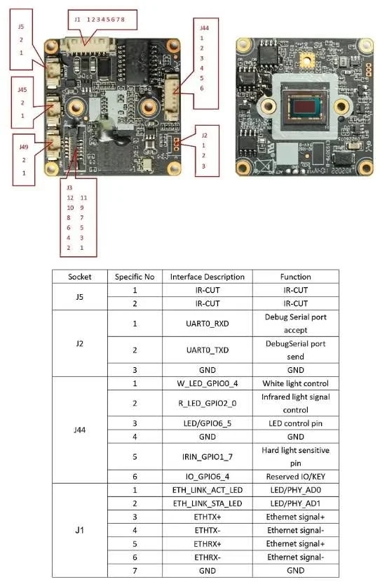
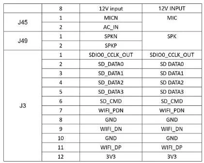
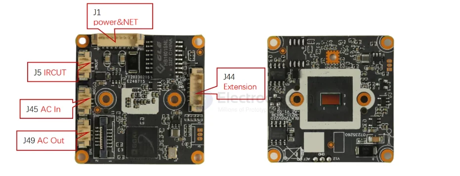
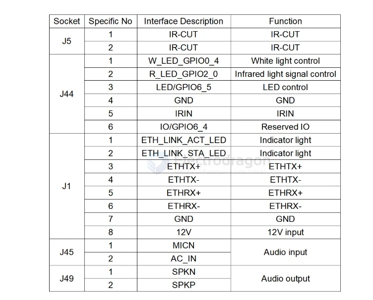
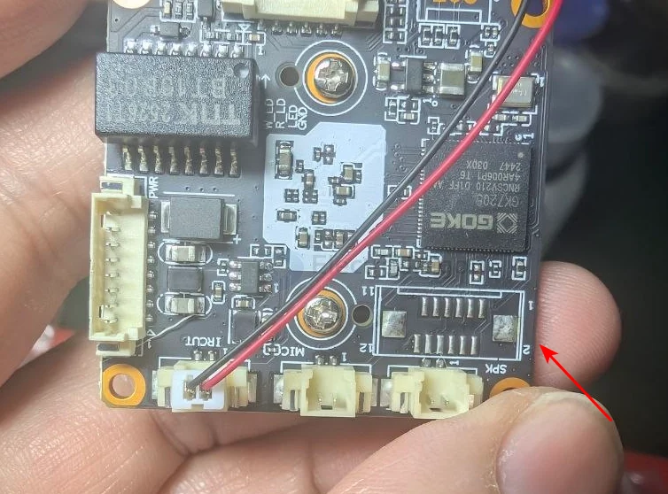

# IVG-G4H-dat

- [[IVG-G2S-dat]] - [[xiongmai-dat]] - [[camera-IP-dat]]

- [[openIPC-dat]] - [[IVG-G4H-dat]] - [[xiongmai-dat]] - [[camera-IP-dat]] - [[IVG-G2S-dat]] 

- [[lens-dat]] - [[lens-mount-dat]]

## app 

- [[VTX-openIPC-dat]] - option 1. == [[IVG-G4H-dat]] ++ [[RTL8812AU-dat]]

## info 

## IVG-G4H

- [[sensor-camera-chip-dat]] == [[SC5239S-dat]] - [[xiongmai-dat]]

- [[GK7205V210-dat]] - [[goke-dat]] - [[camera-IP-dat]]

H.265AI - [[H.265-dat]] - [[H.265-AI-dat]] - [[sensor-camera-dat]]

IVG-G4H是我司开发的一款400万低照度AI智能网络摄像机模组，400万图像，低噪点，双光全彩，夜视效果提升，人脸更清晰。支持人形检测，支持H.265AI编码，主要应用于夜视高清视频监控摄像机。

系统结构

- **传感器**
  - 1/2.9 英寸低照度 CMOS 传感器
  - 彩色：0.01 Lux@F1.2
  - 黑白：0.001 Lux@F1.2

- **视频处理**
  - 嵌入式 RTOS
  - 双核 32 位 DSP（GK7205V210）
  - 纯硬件压缩
  - 看门狗

- **编码**
  - H.265AI（兼容 H.265/H.264）
  - 双码流
  - AVI 格式
  - 码流：0.1 Mbps ~ 10 Mbps 可调
  - 帧率：1 ~ 30 fps 可调
  - 主码流：2560×1440@20 fps、2304×1296@20 fps、1920×1080@25 fps
  - 子码流：800×448@25 fps

- **快门**
  - 1/50（1/60）秒至 1/10000 秒

- **图像功能**
  - 日夜转换：支持 IR-CUT
  - 降噪：支持 2D/3D 降噪
  - 宽动态：支持数字宽动态
  - 自动光圈：无
  - 镜头：无

- **IR-CUT**
  - 线圈内阻：20 Ω
  - 通电电流：小于 200 mA
  - 推荐工作电压：DC 5 V

- **音频处理**
  - 编解码：G.711A
  - 支持双向语音对讲
  - 支持音视频同步

- **音频接口**
  - 1 路音频输入：MIC，选型范围 -28 dB ~ -36 dB，推荐 -33 dB
  - 1 路音频输出：喇叭，推荐 8 Ω/2 W

- **网络接口**
  - 1×RJ45，10/100 Mbps 自适应
  - 与电源接口合并
  - 支持协议：RTSP、FTP、DHCP、NTP、UPnP

- **扩展接口**
  - 无

- **信号接口**
  - 1 路光敏电阻接口
  - 1 路 IR-CUT 驱动接口
  - 支持光敏电阻输入信号联动 IR-CUT 和红外灯

- **云台接口**
  - 无

- **电机接口**
  - 无

- **报警接口**
  - 无

- **无线与存储接口**
  - WIFI 天线接口：无
  - 复位键接口：无
  - SD 卡槽：无

- **业务功能**
  - 支持网页配置、OSD 和移动侦测
  - 移动侦测报警后支持中心提醒和画面联动弹出
  - 支持 FTP 抓图
  - 支持远程客户端监控软件和 MYEYE 平台
  - 提供 SDK 开发包
  - 支持手机监控（iOS、Android）
  - 支持 ONVIF

- **智能分析**
  - 支持人形检测
  - 支持定制其他智能功能

- **可靠性**
  - 全面防雷保护，符合国家及国际标准
  - 7×24 小时、-10℃~65℃测试稳定可靠
  - 含整机测试

- **电源**
  - DC 12 V/2 A
  - 功耗：≤3 W

- **尺寸**
  - 板型尺寸：38 mm×38 mm

- **供电扩展**
  - 支持扩展 PoE 供电

### openIPC 

- [[openIPC-dat]]

GK7205V210 有 OpenIPC 官方支持

⭐ OpenIPC 官方仓库里存在 gk7205v210_lite_defconfig
   官方注释原文：「gk7205v210 is firmware-identical to gk7205v200
   (same SOC_FAMILY, kernel, osdrv)」
   → 直接用 gk7205v200 的 image，设备端 sysupgrade 自动解析
        ↓
⭐ 官方安装指南：openipc.org/cameras/vendors/goke/socs/gk7205v210
        ↓
⭐⭐ 刷了之后：亚秒级延迟（原厂 RTSP 通常 200-500ms）+ 完全离网 + 可精调曝光/增益

⚠️ 但先别刷 —— 三个前置条件：

- 传感器型号（有没有驱动 .so）、
- flash 大小（8M/16M）、
- 需要串口救砖。
- 
- 先按原厂固件跑通 RTSP，再考虑刷。

## pin 

pin V2 

pin V1 

J1 main conn : 
- 1 ETH_LINK_ACT_LED Indicator light
- 2 ETH_LINK_STA_LED Indicator light
- 3 ETHTX+ ETHTX+
- 4 ETHTX- ETHTX-
- 5 ETHRX+ ETHRX+
- 6 ETHRX- ETHRX-
- 7 GND GND
- 8 12V 12V input

J45 J49 Audio

J5 - IR-cut 

J44

- W_LED_GPIO0_4
- R_LED_GPIO2_0
- LED/GPIO6_5
- GND
- IRIN
- IO/GPIO6_4

## details 

- [[IVG-G4H-dat]] - [[conn-FPC-vertical-dat]]

## ref 

