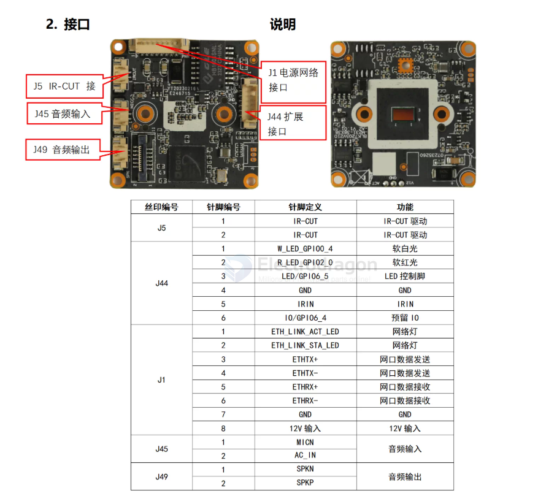

# xiongmai-dat

- [[xiongmai-dat]] - [[IVG-G2S-dat]] - [[chip-cn-dat]] - [[hi3516-dat]] 

## IVG-G4H

GK7205V210 

H.265AI - [[H265-dat]] - [[H265AI-dat]] - [[sensor-camera-dat]]

IVG-G4H是我司开发的一款400万低照度AI智能网络摄像机模组，400万图像，低噪点，双光全彩，夜视效果提升，人脸更清晰。支持人形检测，支持H.265AI编码，主要应用于夜视高清视频监控摄像机。

## ref 

- [[xiongmai]]