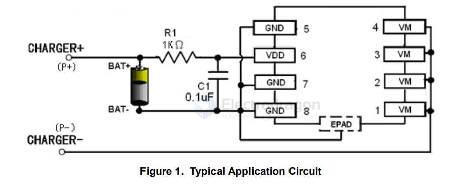

# XB8886-dat

- [[battery-protector-1s-dat]] - [[xysemi-dat]] - [[XB8886-dat]]

The XB8886 (often labeled as XB8886A) is a highly integrated, single-cell lithium-ion and lithium-polymer battery protection IC manufactured by XySemi

- [[XB8886-dat]] - [[SW6208-dat]] - [[xysemi-dat]] - [[battery-protector-1s-dat]] - [[battery-protector-dat]]

The XB8886A is a single-cell (1-cell) Lithium-ion/Lithium-Polymer battery protection IC (Integrated Circuit) manufactured by XySemi.

Key Features and Specifications

• Package Type: SOP8-PP / SOIC-8-EP
• Integrated MOSFET: Low resistance RSS(ON) of ~8.5 mΩ
• Protections Included:
	• Overcharge protection (VCU: 4.30V, release: 4.10V)
	• Overdischarge protection (VDL: 2.40V, release: 3.0V)
	• Two-step overcurrent and short-circuit protection (IOV1: 15A, ISHORT: 40A)
	• Over-temperature protection (OTP: 150°C, recovery: 110°C)
	• Reverse connection and 0V battery charging support
• Low Current Consumption: 3 μA in normal operation, 1.8 μA in power-down mode
• Common Applications: Single-cell lithium battery packs, power banks, and portable digital devices.

## ref 