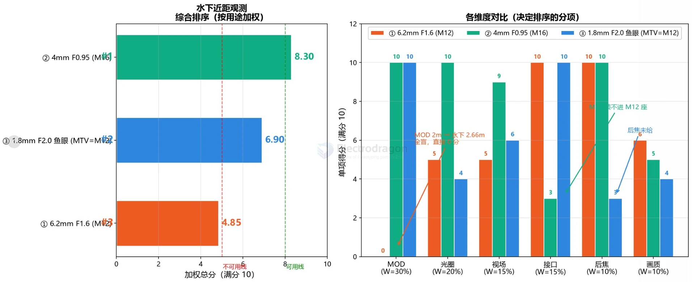
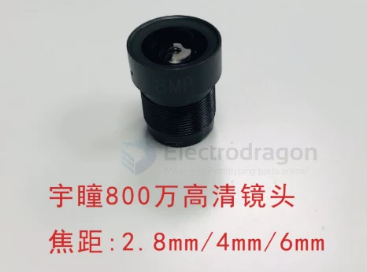
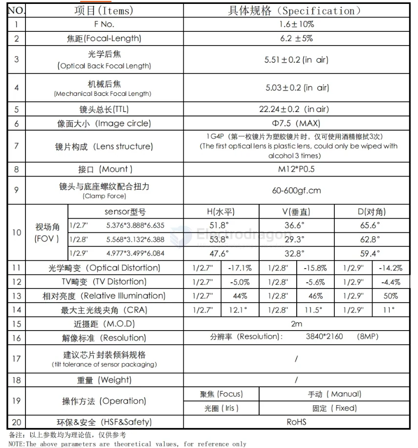

# yutong-dat

- [[lens-dat]] - [[yutong-dat]]

## underwater performance overview 

## 1604-5MP

500万高清鱼眼镜头180度 1.8MM

相对孔径（Aperture D/f'） F1:2.0
焦距<Focal-Length (mm)> 1.8
接口（Mount） MTV
视场角（Field） 180°155°95°
外形尺寸< Dimension (mm)> Φ20×19
重量<Weight(g)> 8.5
近摄距<M.0.D(m)> 0.2

## YT10043-4MM

### ⭐️⭐️ 这镜头的「用途画像」

6.2mm 中长焦 + MOD 2m + 8MP + CRA -11° + 相对亮度 -50%
        ↓
= 典型【道路卡口 / 停车场 / 远距人脸识别】监控镜头
= 为「远、亮、静态」优化

### 镜头参数

- 光圈（F No.）：0.95 ±5%
- 焦距（Focal Length）：4 mm ±5%
- 光学后焦（Optical Back Focal Length）：5.72 ±0.1 mm（in air）
- 机械后焦（Mechanical Back Focal）：5.48 ±0.2 mm（in air）
- 镜头总长（TTL）：31.96 ±0.2 mm（in air）
- 像面大小（Image Circle）：
  - Φ6.6 mm（适用于 1/2.7" Sensor）
  - 最大 Φ6.9 mm
- 镜片构成（Lens Structure）：5G4P
- 接口（Mount）：M16×P0.5
- 镜头与底座螺纹配合扭力（Clamp Force）：60–600 gf·cm

### 视场角（Field of View）

| Sensor 型号 | 水平（H） | 垂直（V） | 对角（D） |
|---|---:|---:|---:|
| 1/2.7" | 92.3° | 48.7° | 109.9° |
| 1/2.8" | 88.4° | 47.0° | 105.2° |
| 1/2.9" | 84.8° | 45.3° | 100.5° |

### 光学指标

| Sensor 型号 | 光学畸变（Optical Distortion） | 相对亮度（Relative Illumination） | 最大主光线夹角（CRA） |
|---|---:|---:|---:|
| 1/2.7" | -40.8% | 59.0% | 8.3° |
| 1/2.8" | -37.5% | 60.0% | 8.1° |
| 1/2.9" | -34.4% | 63.0% | 7.8° |

- 近摄距（M.O.D）：0.2 m
- 分辨率（Resolution）：1920×1080（2 MP）

#### ① 相对亮度：四角只剩中心一半

传感器	相对亮度	四角实际
1/2.7"	-44%	56%
1/2.8"	-46%	54%
1/2.9"	⚠️ -50%	⚠️ 50%

⚠️ 水下本身"上亮下暗" + 镜头 50% 边缘衰减
   ⇒ 四角很暗、噪点集中
⭐ 好镜头应该 ≥70-80%

#### ② 畸变：光学 -14.2% / TV -4.4%

⭐ 光学畸变 -14.2% 与我上轮算的「对角实测比理论大 7.1°」完全吻合 → 互相验证
✅ TV 畸变 -4.4% <5% → 观感可接受
⚠️ 但光学畸变说明边缘像素被拉伸 → 边缘实际分辨率下降
   叠加边缘亮度只剩 50% ⇒ 四角基本没有实用价值

#### CRA

传感器	CRA
1/2.7"	-12.1°
1/2.8"	-11.5°
1/2.9"	-11°

### 投影分辨率

- 中心：160 lp/mm 可清晰分辨
- ∅4.5：125 lp/mm 可清晰分辨
- ∅6：63 lp/mm 可分开线条，拖影约为 1/2
- 英文标注：160 lp/mm clear at center；125 lp/mm clear at Ø4.5；63 lp/mm lines separate at Ø6，approximately 1/2 smear

### 聚焦与光圈

- 聚焦（Focus）：手动（Manual）
- 光圈（Iris）：固定（Fixed）
- 环保要求：符合 RoHS

## YT10096-8MP

## 镜头参数

- 光圈（F No.）：1.6 ±10%
- 焦距（Focal Length）：6.2 mm ±5%
- 光学后焦（Optical Back Focal Length）：5.51 ±0.2 mm（in air）
- 机械后焦（Mechanical Back Focal Length）：5.03 ±0.2 mm（in air）
- 镜头总长（TTL）：22.24 ±0.2 mm（in air）
- 像面大小（Image Circle）：Φ7.5 mm（MAX）
- 镜片构成（Lens Structure）：1G4P
  - 第一枚镜片为塑胶镜片时，仅可使用酒精擦拭 3 次
  - The first optical lens is plastic lens; it could only be wiped with alcohol 3 times
- 接口（Mount）：M12×P0.5
- 镜头与底座螺纹配合扭力（Clamp Force）：60–600 gf·cm

## 视场角（Field of View）

| Sensor 型号 | 水平（H） | 垂直（V） | 对角（D） | Sensor 尺寸（mm） |
| ----------- | --------: | --------: | --------: | ----------------- |
| 1/2.7"      |     51.8° |     36.6° |     65.6° | 5.376×3.888×6.635 |
| 1/2.8"      |     53.8° |     29.3° |     62.8° | 5.568×3.132×6.388 |
| 1/2.9"      |     47.6° |     32.8° |     59.4° | 4.977×3.499×6.084 |

光学畸变（Optical Distortion）
- 1/2.7" - -17.1% 
- 1/2.8" - -15.8% 
- 1/2.9" - -14.2%
TV畸变（TV Distortion）
- 1/2.7" - -5.0% 
- 1/2.8" - -5.6% 
- 1/2.9" - -4.4%
相对亮度（Relative Illumination）
- 1/2.7" - -44% 
- 1/2.8" - -46% 
- 1/2.9" - -50%
最大主光线夹角（CRA）
- 1/2.7" - -12.1° 
- 1/2.8" - -11.5° 
- 1/2.9" - -11°

近摄距（M.O.D） 2m
解像标准（Resolution）分辨率（Resolution）:3840*2160(8MP)

聚焦（Focus）
手动（Manual）
固定（Fixed）
光圈（Iris）

## ref

