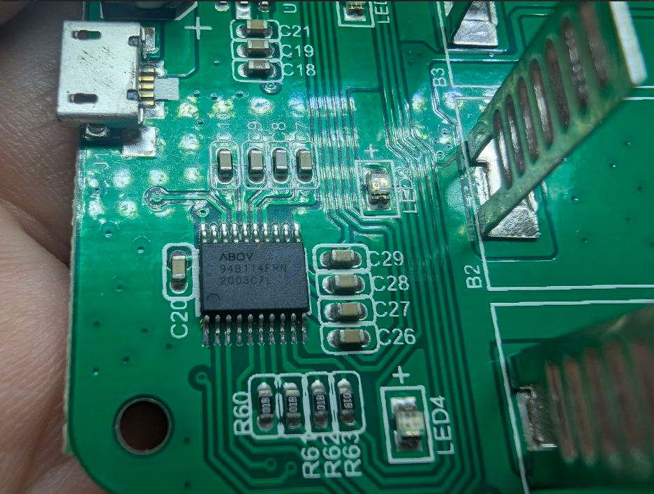

# A94B114FRN-dat

The ABOV A94B114 is an 8-bit CMOS microcontroller (MCU) manufactured by ABOV Semiconductor. Built on an 8051-compatible core, it is designed as a cost-effective controller for small home appliances and battery management systems.

Core Specifications

• CPU Core. 8-bit CM8051-S core operating at up to 16 MHz.
• Memory. 8 KB of Flash memory and 512 bytes of SRAM (256B IRAM and 256B XRAM).
• Operating Voltage. Wide supply voltage range from 2.0 V to 5.5 V.
• Temperature Range. Industrial rating from -40°C to 85°C.

Integrated Peripherals

• Analog-to-Digital Converter (ADC). 12-bit ADC with 10 channels and an integrated 2.5 V LDO.
• Timers and PWM. One 8-bit timer, two 16-bit timers, a watchdog timer, and 16-bit PWM with dead-band control.
• Communication and I/O. Up to 18 general-purpose I/O lines, USART, I2C, and an analog comparator.
• Oscillators. Internal 32 MHz high-frequency oscillator (HFO) and low-frequency oscillator (LFO).

- [[MCU-dat]] - [[ABOV-dat]] - [[A94B114FRN-dat]] - [[battery-charger-dat]]

## ref 

