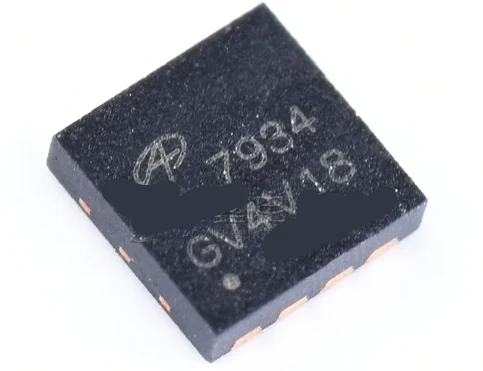

# AOSMD-mosfet-dat

- [[AOSMD-mosfet-dat]] - [[4264E-dat]] - [[AON7934-dat]] - [[mosfet-dat]]

`AON7934`
Low Voltage MOSFETs (12V - 30V)
30V Dual Asymmetric N-Channel AlphaMOS

- [[AOSMD-mosfet-dat]] - [[3400-dat]] - [[3401-dat]] - [[AOSMD-dat]] - [[AOSMD-mosfet-dat]] - [[AOD4184-dat]] - [[AOD4184-dat]] - [[D4184-dat]]

- [[AOSMD-mosfet-dat]] - [[4264E-dat]]

- [[AOSMD-mosfet-dat]] - [[AOSMD-dat]]

- [[3400-dat]] - [[3401-dat]] - [[AOSMD-dat]]

- [[AOD4184-dat]] == AOD4184/AOI4184

- [[AOD403-dat]]

| Model             | Mark | Manufacturers    | Id    | Package         | CH type | VDS max |
| ----------------- | ---- | ---------------- | ----- | --------------- | ------- | ------- |
| AO4435 / SI4435   |      | [[AOSMD-dat]]    | -10.5 | SO-8            | P       | 30V     |
| AO4468            |      | [[AOSMD-dat]]    | 10.5  | SO-8            | N       | 30V     |
| AO3400            | A0T0 | [[AOSMD-dat]]    | 5.8A  | SOT-23          | N       | 30V     |
| AO3401            | A19T | [[AOSMD-dat]]    | 4.3A  | SOT-23          | P       | 30V     |
| AOD403            | D403 | [[AOSMD-dat]]    | 40A   | TO-252          | N       | 40V     |
| AOD4184A          | 4184 | [[AOSMD-dat]]    | 50A   | TO-252          | N       | 40V     |

- [[AO3401-dat]]

## SOP 8 

- [[AO4435A-dat]] - [[AO4410-dat]] - [[AOSMD-mosfet-dat]] - [[ZXW602-dat]] - [[mosfet-dat]] 

The `4410` (such as the `AO4410` or general equivalent 4410-series chips) is a surface-mount N-Channel Enhancement Mode Power MOSFET housed in a standard SOP-8 (or SO-8) package.

Key Specifications

• Type: **N-Channel Power MOSFET**
• Drain-Source Voltage (\(V_{DS}\)): 30V
• Continuous Drain Current (\(I_{D}\)): Typically 10A to 18A (depending on the specific manufacturer variant like UMW AO4410)
• On-Resistance (\(R_{DS(on)}\)): Very low (approx. 5.5mΩ to 14mΩ depending on \(V_{GS}\))
• Gate-Source Voltage (\(V_{GS}\)): ± 12V to ± 20V
• Package: SOP-8 / 8-SOIC

The `4435A` SOP refers to a **P-Channel enhancement-mode MOSFET** housed in a surface-mount SOP-8 (Small Outline Package). Transistors like the `FDS4435A` or `AO4435` are widely used for power management and battery-powered circuits.

## DFN 

- [[mosfet-dat]] - AON7520 (DFN 3.3x3.3) - [[NRF52832-dat]] - [[DFN-dat]] - [[AOSMD-mosfet-dat]] - [[AON7520-dat]] - [[AON6411-dat]]

`AON6411` 20V P-Channel MOSFET

The AON6411 combines advanced trench MOSFET technology with a low resistance package to provide extremely low RDS(ON). This device is ideal for load switch and battery protection applications

## AO3401 

The marking code "341L" typically identifies the NP3401MR-G, a P-Channel Enhancement Mode MOSFET housed in a compact SOT-23 surface-mount package.

## AO3400

The `X01V` is a common silkscreen marking for the AO3400A (or AO3400). It is an N-Channel enhancement-mode MOSFET manufactured by Alpha & Omega Semiconductor, typically housed in a compact SOT-23 package.

- [[CN3302-dat]] - [[AOSMD-dat]] - [[mosfet-dat]]

## ref 

