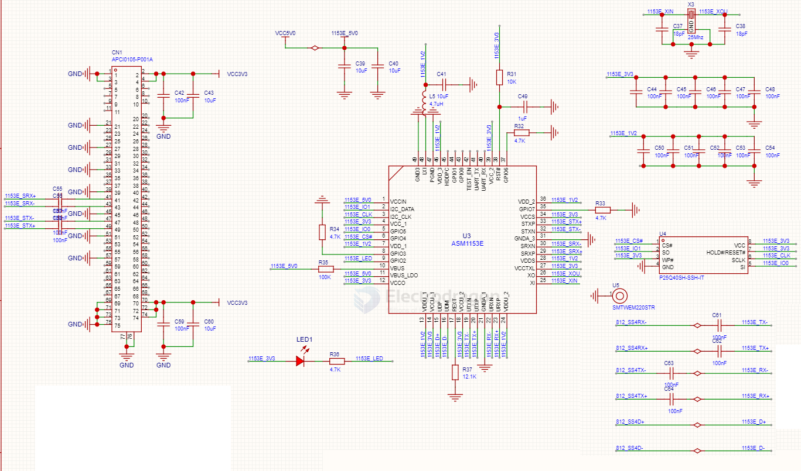

# ASM1153E-dat

- [[ASMedia-dat]] - [[ASM1153E-dat]] - [[USB-3.0-dat]] - [[SATA-dat]]

The ASMedia ASM1153E is a single-chip USB 3.0 (USB 3.2 Gen 1) to Serial ATA (SATA 6Gbps) bridge controller manufactured by ASMedia Technology Inc.

Key Features & Specifications

- • Interface Bridge: Converts USB 3.0/2.0 to SATA III (up to 6Gbps signal bandwidth; backward compatible with SATA 1.5/3.0 Gbps).
- • Protocol Support: Supports USB Mass Storage Class Bulk-Only Transport (BOT) and UASP (USB Attached SCSI Protocol) for faster, more efficient data transfer speeds.
- • Architecture: Integrates an 8-bit microprocessor with embedded RAM/ROM and self-designed SuperSpeed USB and SATA PHYs.
- • Power Management: Optimized for low power consumption and pin-to-pin backward compatible with older ASM1053 designs.
- • Common Use Cases: Frequently found in external 2.5-inch/3.5-inch hard drive enclosures, mSATA-to-USB adapters, and SATA-to-USB cables.

## SCH 

## ref 