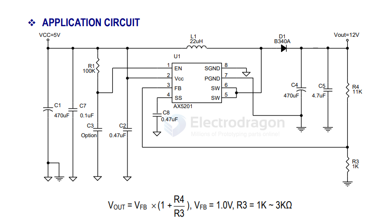
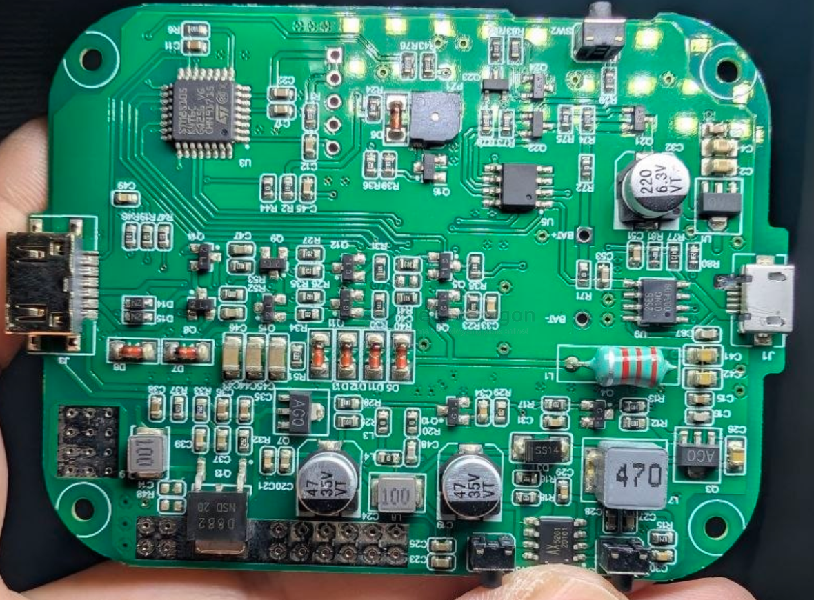

# AX5201-dat

- [[AXElite-dat]] - [[AX5201-dat]] - [[dcdc-boost-dat]]

## FEATURES
- Input voltage：3V to 20V
- Output voltage：3.3V to 32V
- Duty ratio：0% to 85% PWM control
- Oscillation frequency：500KHz.
- Enable and Thermal Shutdown function.
- Internal Current limit.
- Built-in N-channel MOSFET
- SOP-8L with Exposed pad Pb-Free package.

## SCH 

## build 

D882 2SD8823A/40V NPN TO-252 Audiopower transistor

- [[STM8-dat]] - [[AX5201-dat]] - [[XT2052-dat]]

## ref 

