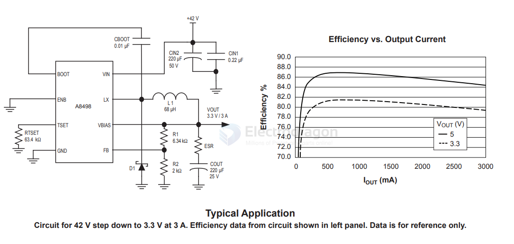

# A8498-dat

- [[allegro-dat]] - [[A8498-dat]] - [[dcdc-down-dat]]

Wide Input Voltage 3.0 A Step-Down Regulator

FEATURES AND BENEFITS

- 8 to 50 V input range
- Integrated DMOS switch
- Adjustable fixed off-time
- Highly efficient
- Adjustable 0.8 to 24 V output

## app 

## ref 