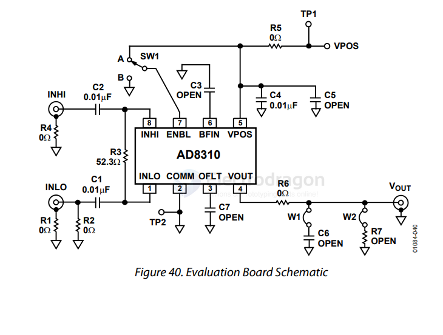

# AD8310-dat

- [[AD8310-dat]] - [[AD-amplifier-dat]] - [[amplifier-dat]] - [[Analog-device-dat]]

https://www.analog.com/media/en/technical-documentation/data-sheets/ad8310.pdf

Fast, Voltage-Out, DC to 440 MHz, 95 dB Logarithmic Amplifier

## SCH 

## ref 