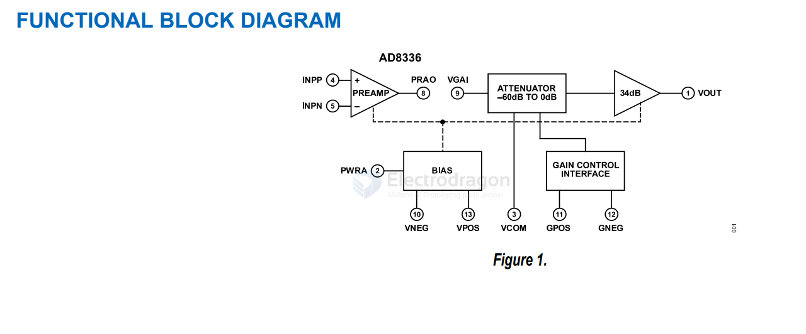

# AD8336-dat

- [[AD8336-dat]] - [[AD-amplifier-dat]] - [[analog-device-dat]]

https://www.analog.com/media/en/technical-documentation/data-sheets/ad8336.pdf

## GENERAL DESCRIPTION

The AD8336 is a low noise, single-ended, linear in dB, general-purpose variable gain amplifier, usable over a large range of supply voltages. It features an uncommitted preamplifier with a usable gain range of 6 dB to 26 dB. The VGA gain range is 0 dB to 60 dB, with absolute gain limits of −26 dB to +34 dB. When the preamplifier gain is adjusted for 12 dB, the combined 3 dB bandwidth of the preamplifier and VGA is 100 MHz, and the amplifier is fully usable to 80 MHz. With ±5 V supplies, the maximum output swing is 7 V p-p.

Because of the X-AMP® architecture, frequency response is maintained across the entire gain range of the VGA. The differential gain control interface provides precise linear in dB gain scaling of 50 dB/V over the temperature span of −55°C to +125°C and is simple to interface with a variety of external sources.

The large supply voltage range makes the AD8336 suited for industrial medical applications and video circuits. Dual-supply operation enables bipolar input signals, such as those generated by photodiodes or photomultiplier tubes.

The fully independent voltage feedback preamplifier allows both inverting and noninverting gain topologies. The AD8336 can be used within the specified gain range of −14 dB to +60 dB by selecting a preamplifier gain between 6 dB and 26 dB and choosing appropriate feedback resistors. For the nominal preamplifier gain of 4×, the overall gain range is −14 dB to +46 dB.

If required, quiescent power is limited to a safe level by asserting the PWRA pin.

## FEATURES
- ► Low noise
- ► Voltage noise: 3 nV/√Hz
- ► Current noise: 3 pA/√Hz
- ► Small-signal BW: 115 MHz
- ► Large-signal BW: 2 V p-p = 80 MHz
- ► Slew rate: 550 V/µs, 2 V p-p
- ► Gain ranges (specified)
- ► −14 dB to +46 dB
- ► 0 dB to 60 dB
- ► Gain scaling: 50 dB/V
- ► DC-coupled
- ► Single-ended input and output
- ► Supplies: ±3 V to ±12 V
- ► Temperature range: −55°C to +125°C
- ► Power
- ► 150 mW at ±3 V, −55°C < T < +125°C
- ► 84 mW at ±3 V, PWRA = 3 V

## APPLICATIONS
- ► Industrial process controls
- ► High performance AGC systems
- ► I/Q signal processing
- ► Video
- ► Industrial and medical ultrasound
- ► Radar receivers

## diagram

## ref 

