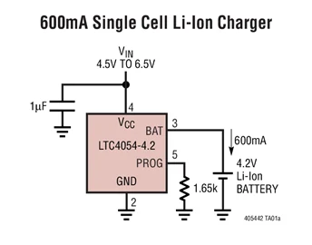

# LTC4054-dat 

- [[LTC4054-dat]] - [[TP4054-dat]] - [[shouding-dat]]

## battery charger 

LTC4054

LTH7 == LTH7 (officially the LTC4054ES5-4.2) is a widely used, single-cell lithium-ion battery charger IC. Packaged in a compact SOT-23-5, it is highly favored for small, portable electronics and DIY hardware projects

- [[fuman-dat]]

- [[LTC4054]]

## AX540S4

The AX540S4 (often referenced or compatible with AX4054 / AXS4054) is a single-cell Lithium-ion / Li-polymer battery charging management IC housed in a compact SOT23-5 (or SOT-23-5L) surface-mount package.

Key Characteristics

• Function: Linear Li-ion battery charger (pin- and functional-compatible with popular 4054-family chargers like the TP4054, TC4054, and LTC4054).
• Package: 5-lead SOT23 (SOT-23-5).
• Input Voltage Range: Typically 4.5V to 5.5V.
• Charging Current: Programmable/constant current up to around 500mA–600mA.
• Common Applications: Portable electronics, USB-powered single-cell Li-ion/Li-po battery chargers, and small space-constrained circuit boards.

## apps 

- [[toothbrush-electric-dat]]

## ref 

