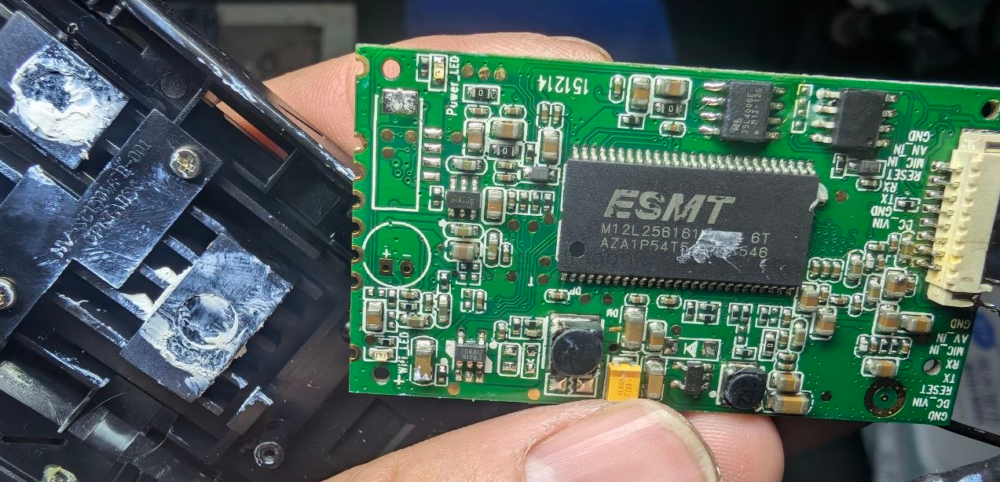

# M12L2561616A-dat

- [[ESMT-dat]] - [[M12L2561616A-dat]] - [[SRAM-dat]] 

The ESMT `M12L2561616A` is a 256-Mbit (16M x 16) single-data-rate Synchronous DRAM (SDRAM) IC from Elite Semiconductor Memory Technology Inc.

Key Specifications

• Memory Density: 256 Mbit (organized as 4M x 16-bit x 4 banks, or 16M x 16).
• Supply Voltage: 3.3V (3V–3.6V range).
• Clock / Speed: Available in speed grades up to 143 MHz, 166 MHz, and 200 MHz (depending on suffix variant).
• Packages: 54-pin TSOP-II or 54-ball BGA.
• Operating Temperature: Commercial grade (0°C to +70°C) or Industrial grade (-40°C to +85°C), depending on part suffix.
• Refresh & Modes: Auto and self refresh (8K refresh cycle / 64ms period), programmable CAS latency (2 & 3) and burst lengths (1, 2, 4, 8, and full page).

## ref 