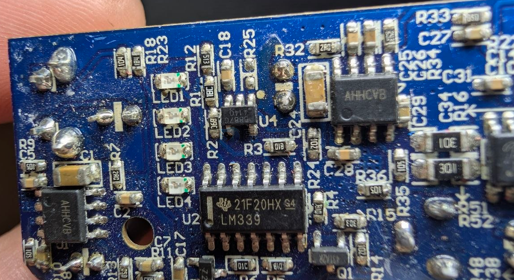
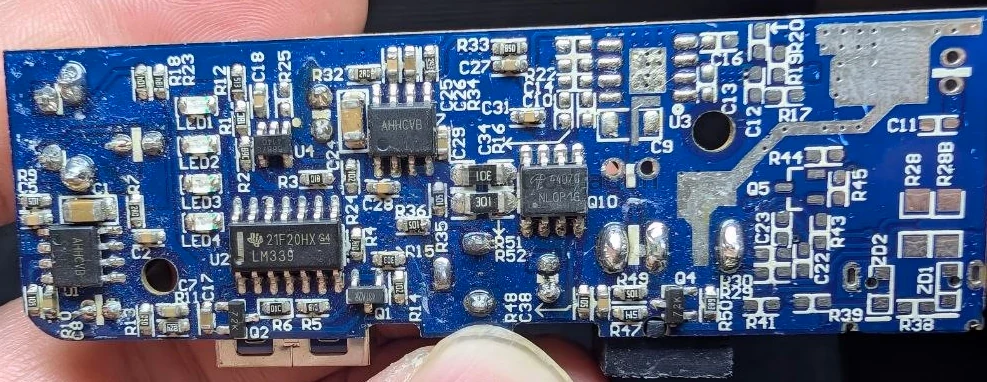

# LM339-dat

- [[LM339-dat]] - [[LMxx-dat]]

The LM339 is a popular quad differential comparator IC featuring four independent precision voltage comparators in a single package. 

Designed for wide-range single ( 2 to 36V ) or dual ( +-1V to +-18V ) supply operation, it offers low input offset voltage (2mV-5mV), low supply current, and is compatible with TTL, MOS, and CMOS logic.

## build 

build 1 

6887C 
AHHCVB

## ref 

