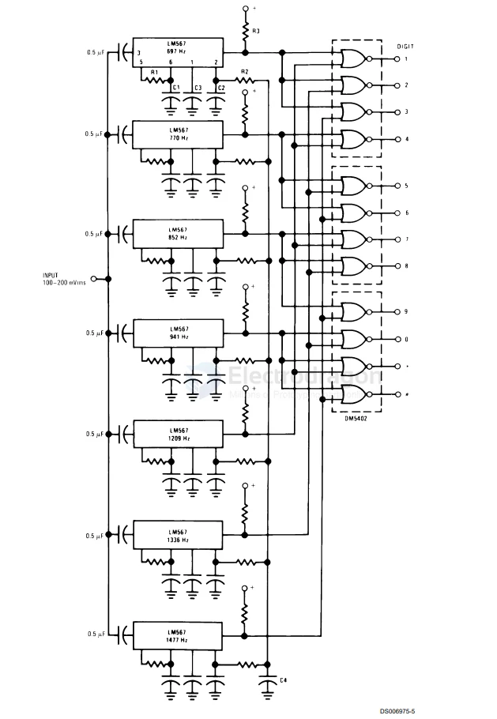
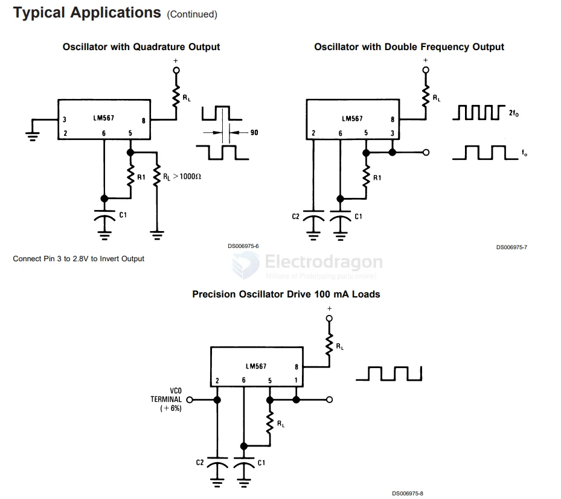
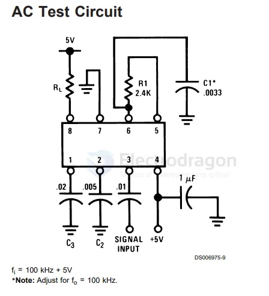

# LM567-dat

- [[SSL1027-dat]] 

The `LM567` (and LM567C) is a general-purpose tone decoder integrated circuit (IC) that pulls its output low (sinking up to 100 mA) when an input signal falls within a set frequency band. It uses internal I and Q detectors driven by a voltage-controlled oscillator (VCO), with external components setting center frequency, bandwidth, and output delay. You can review the full specifications in the Texas Instruments LM567x Tone Decoder datasheet.

Key Specifications

• Center frequency: Adjustable from 0.01 Hz to 500 kHz (20:1 range with an external resistor)
• Bandwidth: Adjustable from 0% to 14%
• Output: Open-collector / logic-compatible switch to ground, up to 100 mA sink current
• Supply voltage: Typically 4.75 V to 9 V (datasheet limits vary slightly by revision/variant)
• Packages: 8-pin PDIP (DIP-8) and 8-pin SOIC

Common Applications

- • Touch-tone (DTMF) and CTCSS tone decoding
- • Frequency monitoring, control, and ultrasonic/remote switches
- • Wideband FSK demodulation and paging decoders
- • Precision oscillators

- [[DTMF-dat]] - [[frequency-monitoring-dat]] - [[tone-decoder-dat]]

## SCH

STD 

Component values (typ)
- R1 6.8 to 15k
- R2 4.7k
- R3 20k
- C1 0.10 mfd
- C2 1.0 mfd 6V
- C3 2.2 mfd 6V
- C4 250 mfd 6V

STD2 

AC Test Circuit

## ref 

