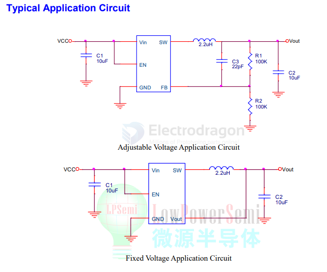

# LP3220-dat

- [[LP3220-dat]] - [[lowpowersemi-dat]]

1.5MHz, 1.2A Step-Down Converter

https://www.lowpowersemi.com/storage/files/2026-04/ae090ffa46c38a0ab1f3f1fcf34b19f4.pdf

General Description
The LP3220 is a 1.5MHz constant frequency current
mode PWM step-down converter. It is ideal for
portable equipment which requires very high current
up to 1.2A from single-cell Lithium-ion batteries while
still achieving over 94% efficiency during peak load
conditions. The LP3220 also can run at 100% duty
cycle for low dropout operation, extending battery life
in portable systems while light load operation provides
very low output ripple for noisy sensitive applications.
The LP3220 can supply up to 1.2A output load current
from an input voltage 2.2V to 5.5V and the output
voltage can be regulated as low as 0.61V. The high
switching frequency minimizes the size of external
components while keeping switching losses low. The
internal slope compensation setting allows the device
to operate with smaller inductor values to optimize size
and provide efficient operation. 

Features
 Input Voltage Range: 2.2V to 5.5V
 Output Voltage Range: 0.61V to VIN
 1.2A Output Current
 High Efficiency: Up to 94%
 100% Duty Cycle in Dropout
 Low Shutdown Current: <1uA
 1.5MHz Switching Frequency
 Soft-star Function
 Short Circuit Protection
 Thermal Fault Protection
 SOT23-5 Package
 RoHS Compliant and 100% Lead (Pb)-Free

Applications
 Portable Instruments
 DSP Core Supplies
 Cellular Phone and Smart mobile phone
 PDA
 GPS Applications

## SCH

STD 

## build 

- [[LP3220-dat]] - [[lowpowersemi-dat]] - [[Massager-dat]] - [[AC7916-dat]] 

## ref 

