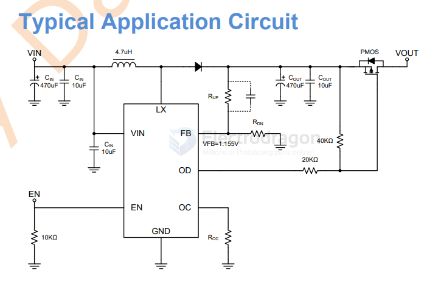
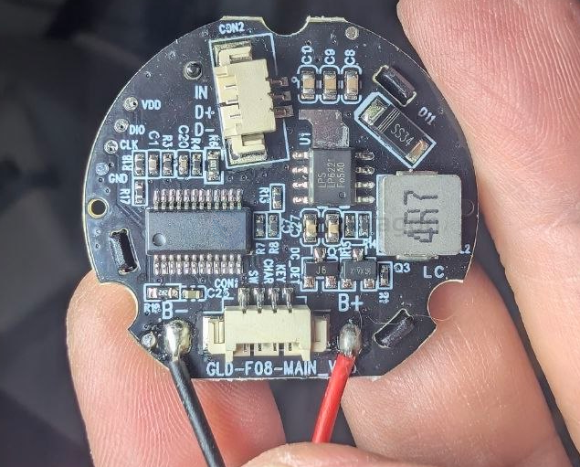
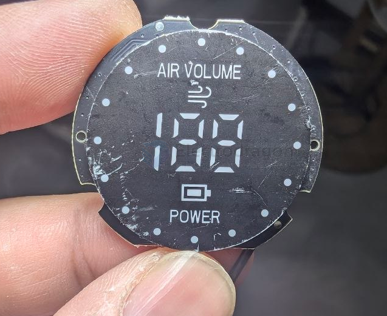

# LP6221A-dat

- [[LowPowerSemi-dat]] - [[LP6221A-dat]] - [[dcdc-boost-dat]] == 10A - High Efficiency 10A Boost Converter

Features
⚫ Up to 94% efficiency
⚫ Output completely off at Shutdown Mode
⚫ Output voltage Up to 20V
⚫ Over Current Protection
⚫ 450KHz fixed frequency switching
⚫ High switch on current: 10A
⚫ Available in ESOP-8/DFN-10(3*3mm) Package

Description
The LP6221A is a current mode boost DC-DC
converter. Its PWM circuitry with built-in 10A
current power MOSFET makes this converter
highly power efficiently. The LP6221A
implements a constant frequency 450KHz PWM
control scheme. The LP6221A can drive up to
20V output voltage
The LP6221A includes under-voltage lockout,
current limiting, and thermal overload protection
to prevent damage in the event of an output
overload. The LP6221A is available in ESOP-8 /
DFN-10 package.

## sch 

std 

## build 

- [[display-dat]] - [[LP6221A-dat]]

## ref 