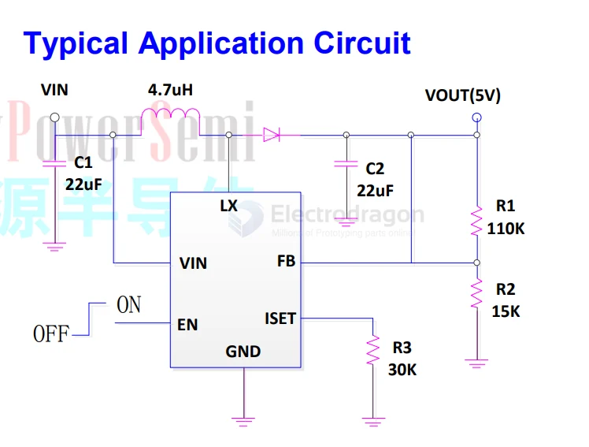

# LP6222-dat

- [[LowPowerSemi-dat]] - [[LP6222-dat]] == 5A - [[dcdc-down-dat]]

High Efficiency Boost DC/DC Convertor

General Description
The LP6222 is a current mode boost DC-DC converter.
Its PWM circuitry with built-in 4.8A current power
MOSFET makes this converter highly power efficiently.
The LP6222 implements a constant frequency 1MHz
PWM control scheme. The high frequency PWM
operation also saves board space by reducing external
component sizes. The LP6222 features automatic
shifting to pulse frequency modulation mode at light
loads.Highly integration and internal compensation
network minimizes as 6 external component counts.
Optimized operation frequency can meet the
requirement of small LC filters value and low operation
current with high efficiency.
The LP6222 includes under-voltage lockout, current
limiting, and thermal overload protection to prevent
damage in the event of an output overload. The
LP6222 is available in a small SOT23-6&ESOP8
package.

Features
 Up to 90% efficiency
 Output to Input Disconnect at Shutdown Mode
 Shut-down current:<1uA
 Output voltage Up to 9V
 Internal Compensation, Soft-start
 1MHz fixed frequency switching
 High switch on current:4.8A(ESOP8)
 Available in SOT23-6&ESOP8 Package

## sch 

std 

## build 

## ref 

