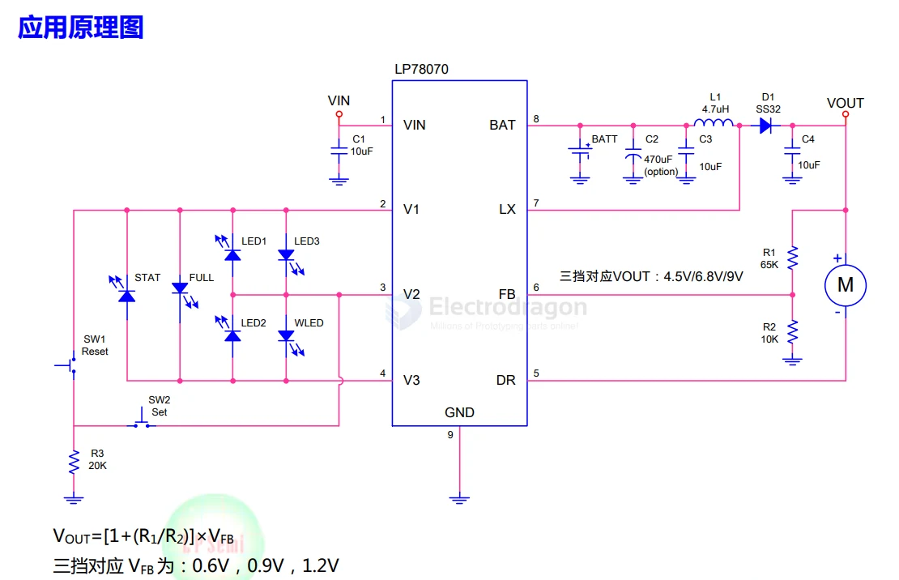
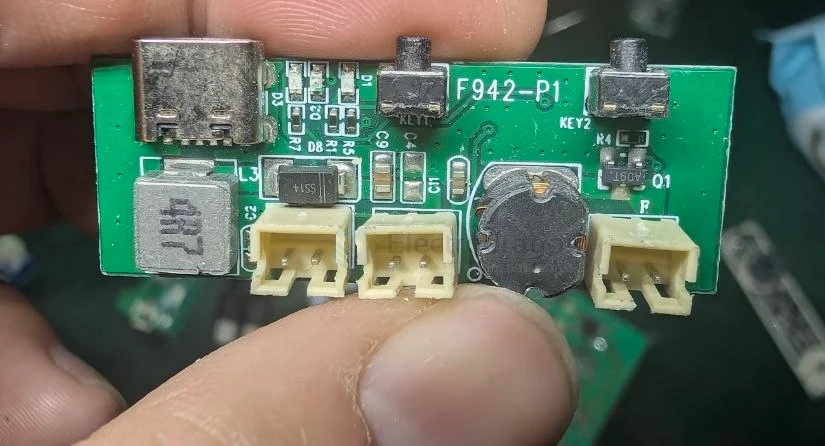
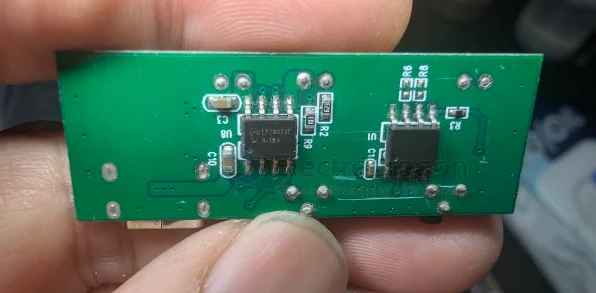

# LP78070-dat

- [[LP78070-dat]] - [[lowpowersemi-dat]] - [[fan-driver-dat]]

## SCH 

## build 

- [[fan-dat]] - [[motor-dat]] 

## LP78070F ?? 

(800mA Linear Li-Ion Battery Charger)

If the marking on your component is LP78070F (where the 0 is often mistaken for a D), it is a standalone single-cell lithium-ion battery charger.
• Function. Constant-current / constant-voltage (CC/CV) linear charger for single-cell Li-ion batteries.
• Charge Current. Up to 800mA programmable charge current.
• Package. Commonly housed in an ESOP-8 or SOT-23-5/6 style package depending on the sub-variant.

## ref 