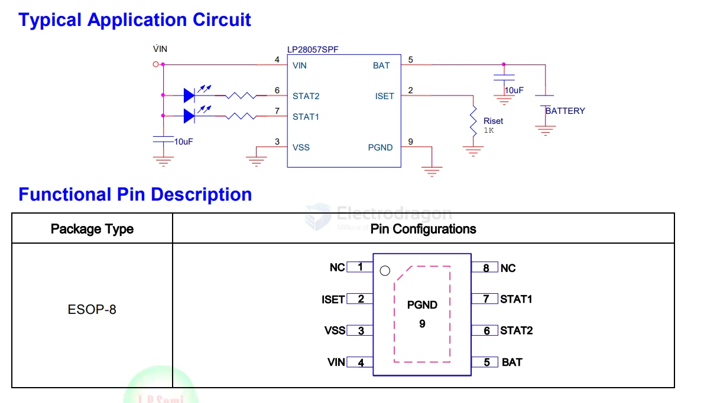

# LowPowerSemi-dat

- [[LP7807-dat]] - [[lowpowersemi-dat]] - [[TWS-dat]] 

- [[LP78070-dat]] - [[lowpowersemi-dat]] - [[battery-charger-1s-dat]] - [[fan-driver-dat]]

- [[LP7810-dat]] - Ultra-high Efficiency TWS Charging Case Manager - [[TWS-dat]]

- [[LP4068-dat]] - [[battery-charger-1s-dat]] - [[TP4068-dat]]

- [[LP4073-dat]] - [[lowpowersemi-dat]]

- [[LowPowerSemi-dat]] - [[LP3987-dat]] - [[LDO-dat]]

- [[lowpowersemi-dat]] - [[LP28057-dat]] - [[battery-charger-1s-dat]] - [[A3-dat]]

- [[LowPowerSemi-dat]] - [[LP6222-dat]] == 5A - [[dcdc-down-dat]]

- [[LowPowerSemi-dat]] - [[LP6221A-dat]] - [[dcdc-boost-dat]] == 10A - High Efficiency 10A Boost Converter

- [[LP3220-dat]] - [[lowpowersemi-dat]]

`LP28057`

1.2A Single-chip Li-ion Charge with Protection of Reverse Connection of Battery

## ref 