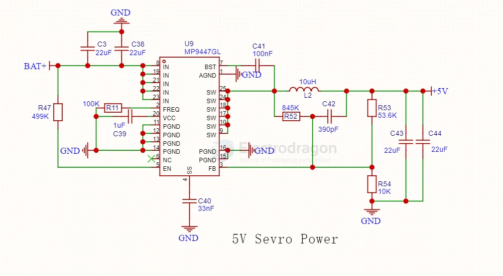
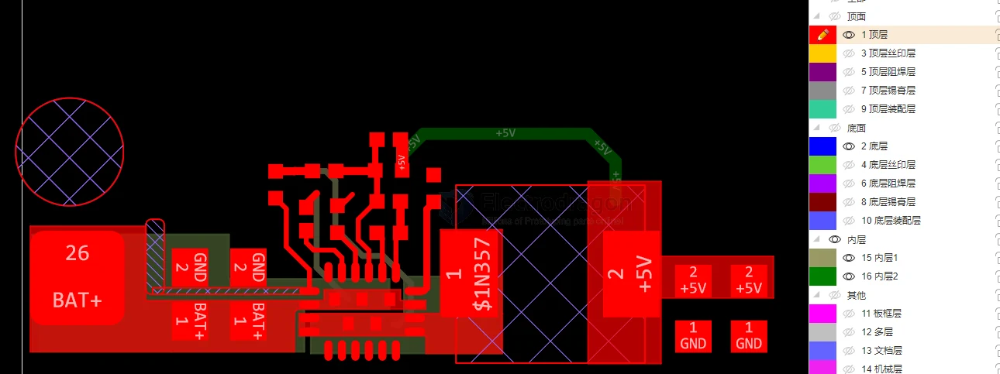

# MP9447-dat

High-Efficiency, Fast-Transient, 5A, 36V Synchronous, Step-Down Converter

- [[MPS-dat]] - [[MP9447-dat]] == 36V 5A 

## SCH

## PCB 

- [[PCB-layer-4-dat]] - [[MP9447-dat]]

## build 

build 1 - [[SSC338-dat]] - [[sigmastar-dat]]

## ref 

