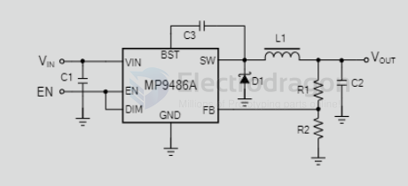

# MP9486-dat

- [[MPS-dat]] - [[MP9486-dat]] - [[dcdc-down-dat]] == 100V 3.5A

MP9486A 
  
100V 输入，3.5A峰值电流限降压转换器

描述 
MP9486A是一款高压降压型开关稳压器，可输
出高达 1A的持续电流至负载。它集成了一个高
压高端 MOSFET，提供3.5A的典型峰值电流限。

其4.5V至100V 的宽输入电压范围可适用于各种
降压应用，是汽车、工业和照明应用的理想之选。

采用滞环电压控制模式，可快速响应负载跳变。

MPS独有的反馈控制方案可以最大限度地减少
外部器件的使用数量。 

高达1MHz的开关频率支持选择小尺寸的器件。
过温保护和短路保护（SCP）确保了其工作的稳
定性和可靠性。170μA的静态电流允许其用于电
池供电应用中。 

MP9486A 采用带散热焊盘的SOIC-8封装。

特性 
  4.5V至100V宽输入电压范围 
  3.5A典型峰值开关电流限值 
  滞环控制：无补偿设计需要 
  高达1MHz开关频率 
  可为LED应用提供PWM调光控制输入 
  集成上管MOSFET带短路保护（SCP） 
  170μA 静态电流 
  过温保护 
  采用带散热焊盘的SOIC-8封装 
应用 
  电动摩托车、电动自行车控制电源供电 
  太阳能系统 
  汽车系统电源 
  工业电源供电 
  高功率LED驱动器

## SCH 

STD 

## ref 