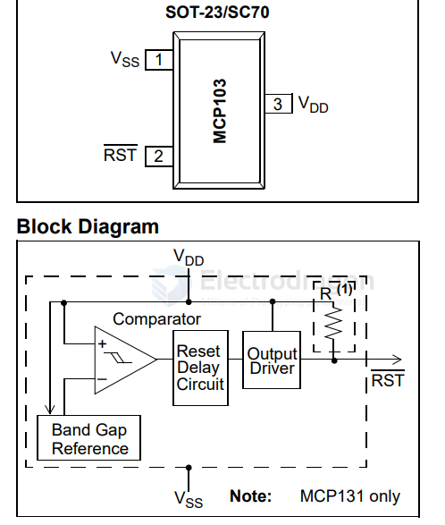

# MCP121-dat

- [[MCP121-dat]] - [[microchip-dat]] - [[voltage-supervisor-dat]]

1uA Supervisor Open Drain Active Low

MCP102/MCP103/MCP121/MCP131 - Micropower Voltage Supervisors

Device: 

- `MCP102`: MicroPower Voltage Supervisor, push-pull
- `MCP102T`: MicroPower Voltage Supervisor, push-pull (Tape and Reel)
- `MCP103`: MicroPower Voltage Supervisor, push-pull
- `MCP103T`: MicroPower Voltage Supervisor, push-pull (Tape and Reel)
- `MCP121` MicroPower Voltage Supervisor, open-drain
- `MCP121T`: MicroPower Voltage Supervisor, open-drain (Tape and Reel)
- `MCP131` MicroPower Voltage Supervisor, open-drain
- `MCP131T`: MicroPower Voltage Supervisor, open-drain (Tape and Reel)

- [[open-drain-dat]] - [[push-pull-dat]] - [[circuits-dat]]

- [[MCP121]] - [[MCP121-dat]]

## ref 

