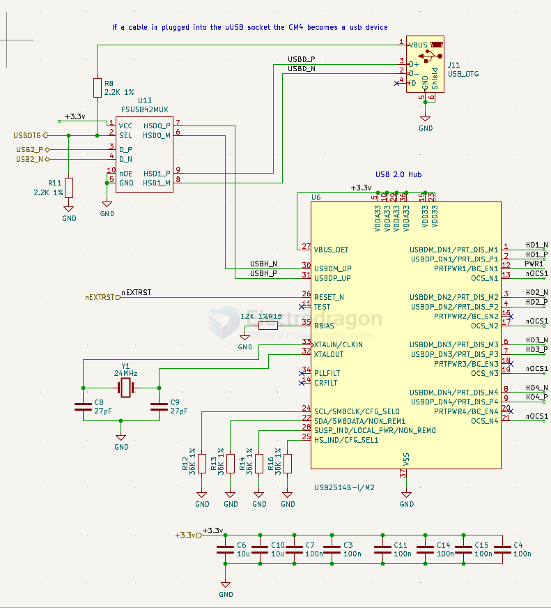
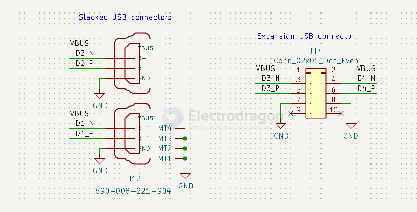
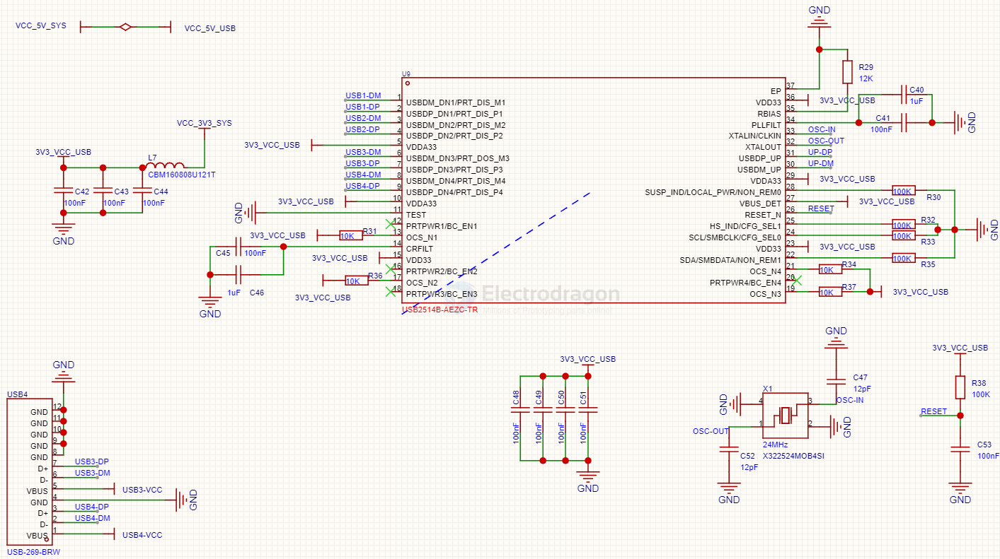
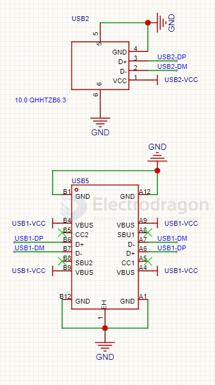
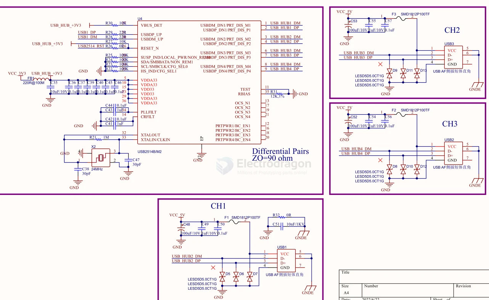

# USB2514B-dat

## USB2514

[USB2514 - USB251xB/USB251xBi USB 2.0 Hi-Speed Hub Controller Data Sheet](https://ww1.microchip.com/downloads/aemDocuments/documents/OTH/ProductDocuments/DataSheets/00001692C.pdf)

The Microchip USB251xB/xBi hub is a family of lowpower, configurable, MTT (multi transaction translator) hub controller IC products for embedded USB solutions. 

The x in the part number indicates the number of downstream ports available, while the B indicates battery charging support. 

The Microchip hub supports lowspeed, full-speed, and hi-speed (if operating as a hispeed hub) downstream devices on all of the enabled downstream ports.

The USB2514 is a low-power, 4-port USB 2.0 high-speed hub controller IC manufactured by Microchip Technology.

Key Features & Specifications

- Ports: Supports up to 4 downstream USB 2.0 ports.
- Technology: Features Microchip's MultiTRAK™ technology, which provides a dedicated transaction translator for each port to improve data throughput in mixed-speed (low, full, and high-speed) USB environments.
- Configuration: OEM configuration options are available via an external I²C EEPROM or an SMBus slave port.
- Proprietary Features: Includes PortMap (flexible port mapping/disabling), PortSwap (programmable differential-pair pin locations for easier PCB routing), and PHYBoost (programmable signal drive strength).
- Packages Available: Offered in 36-pin QFN (6x6 mm) and 48-pin VQFN/QFN packages.
- Lifecycle Status: The original USB2514 is marked as Not Recommended for New Designs by Microchip, with recommendations to use the updated USB251xB / USB251xBi family (such as the USB2514B) instead.

## SCH 

SCH 2 

- [[SY6280-dat]]

SCH 1

##

## ref 

- [[microchip-dat]]