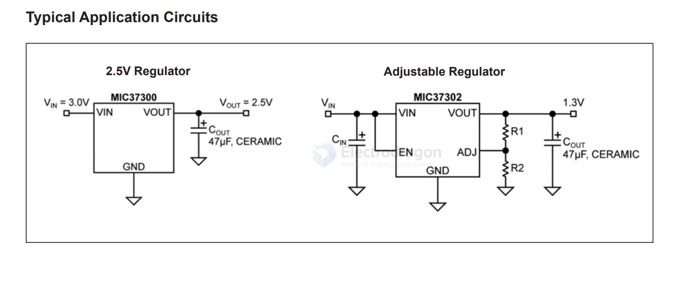

# MIC37301-dat

- [[microchip-power-dat]] - [[micrel-dat]] - [[MIC37301-dat]] == 3A 1.8V LDOREG EPAD8SOIC MIC37301-1.8YME

Features
• 3A Minimum Output Current
• 500 mV Maximum Dropout Voltage over
Temperature
- Recommended for 3.0V to 2.5V Conversion
- Recommended for 2.5V to 1.8V, 1.65V,
or 1.5V
Conversion
• Stable with Ceramic or Tantalum Capacitors
• Wide Input Voltage Range
-VIN: 2.25V to 6.0V
• +1.0% Initial Output Tolerance
• Fixed and Adjustable Output Voltages:
- MIC37300: 3-pin S-PAK Fixed Voltages
- MIC37301: 5-pin S-PAK or 8-pin ePad SOIC Fixed Voltages with Flag
- MIC37302: 5-pin Adjustable Voltage
- MIC37303: 8-pin ePad SOIC, DFN
Adjustable Voltage with Flag
• Excellent Line and Load Regulation Specifications
• Thermal Shutdown and Current Limit Protection
• Reverse-Leakage Protection
• Low Profile S-PAK Package

## ref 

