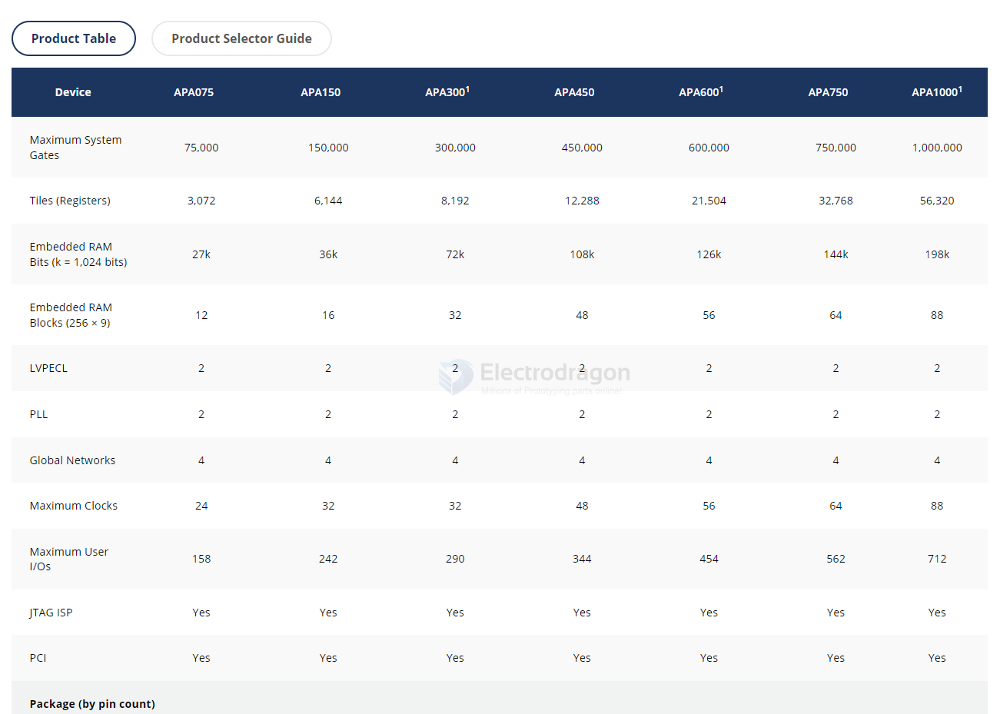

# microchip-FPGA-dat

- [[microchip-dat]] - [[microchip-FPGA-dat]]

M2S005-VFG400I == ARM® Cortex®-M3 System On Chip (SOC) IC SmartFusion®2 FPGA - 5K Logic Modules 166MHz 400-VFBGA (17x17)

- [A3PE1500 == Ultra Low Density FPGAs](https://www.microchip.com/en-us/product/a3pe1500)

## overview 1 

## APA300

Ultra Low Density FPGAs

https://www.microchip.com/en-us/product/apa300#Documentation

## ref 

