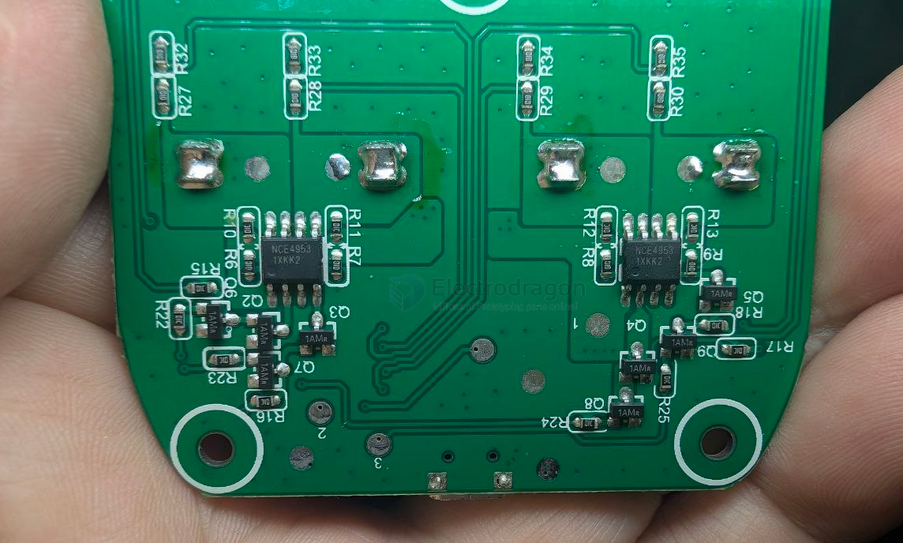
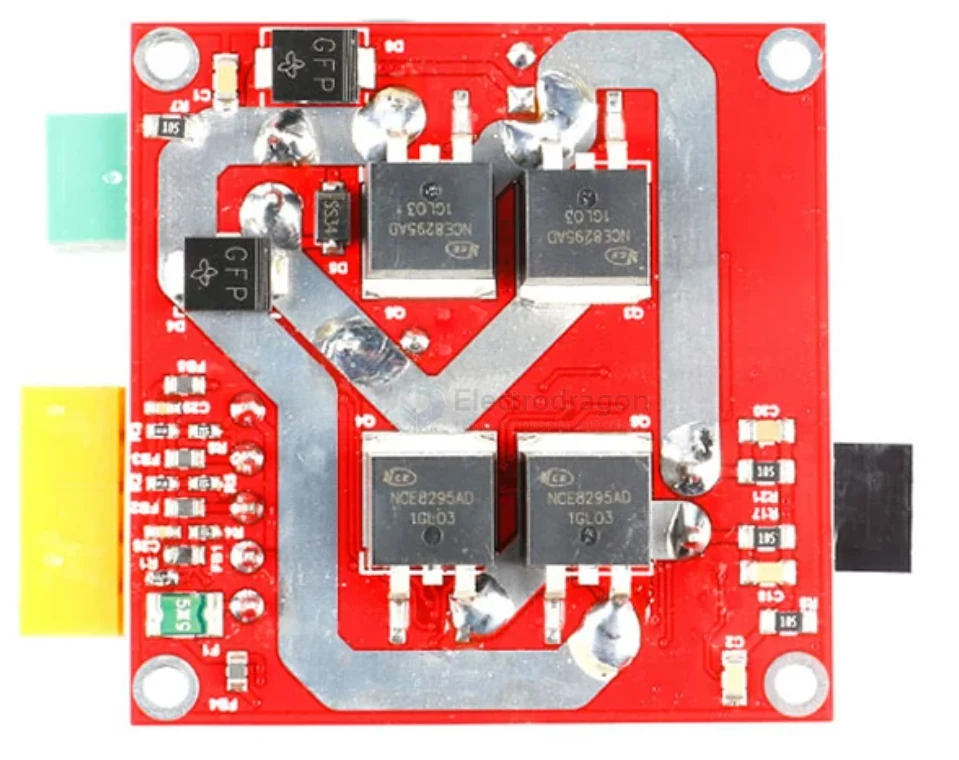
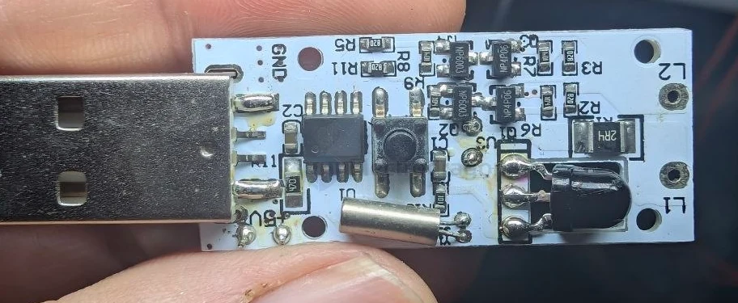

# NCEpower-mosfet-dat

- [[mosfet-dat]] - [[NCEpower-dat]] - [[NCEpower-mosfet-dat]] - [[mosfet-dat]] - [[NCE6050-dat]]

- [[NCEpower-mosfet-dat]] - [[NCE2060K-dat]] - NCE N-Channel Enhancement Mode Power MOSFET 

| model    | current | mark | type             | price | package | channel | Vds |
| -------- | ------- | ---- | ---------------- | ----- | ------- | ------- | --- |
| NCE40P70 | 70A     |      |                  |       |         |         | 40V |
| NCE4080  |         |      |                  |       |         |         |     |
| NCE6050  |         |      | [[ncepower-dat]] | 50A   | TO-252  | N       | 60V |

NCE6050

- [[NCE2060K-dat]] - NCE N-Channel Enhancement Mode Power MOSFET 

NCE4080 / NCE40P70

## SOP-8 dual 

### NCE4953

The `NCE4953` is a dual P-Channel enhancement mode power MOSFET manufactured by Wuxi NCE Power Semiconductor Co., Ltd, typically housed in an SOP-8 (SO-8) package.

Key Specifications

• Type: Dual P-Channel Enhancement Mode Trench MOSFET
• Package: SOP-8 / SO-8
• Drain-Source Voltage (\(V_{DS}\)): -30 V
• Gate-Source Voltage (\(V_{GS}\)): ±20 V
• Continuous Drain Current (\(I_{D}\)): -5.1 A to -7.3 A (depending on conditions/mounting)
• On-Resistance (\(R_{DS(on)}\)): ~0.029 – 0.035 Ω typ. at \(V_{GS} = -10\,\text{V}\)
• Total Gate Charge (\(Q_{g}\)): ~17 nC typ.
• Operating Temperature (\(T_{j}\)): -55°C to +150°C

Common Applications

• Load switches
• Pulse-Width Modulation (PWM) applications
• Power management circuits

- [[NCEpower-mosfet-dat]] - [[battery-charger-dat]]

## 2060K 

The `2060K` (such as the NCE2060K by Wuxi NCE Power or equivalent units from Fuman/Fine Made) is an N-Channel enhancement-mode power MOSFET packaged in a surface-mount TO-252-2 (DPAK) housing.

## NCE8295 

## NCE6003X

NP4P06 + NCE6003

- [[NCE6003-dat]] - [[NCEpower-mosfet-dat]]

NCE N-Channel Enhancement Mode Power MOSFET

VDS =60V,ID =3A

## build 

- [[natlinear-dat]] - [[NCEpower-mosfet-dat]] - [[NP4P06-dat]] - [[NCE6003-dat]] 

## ref 

