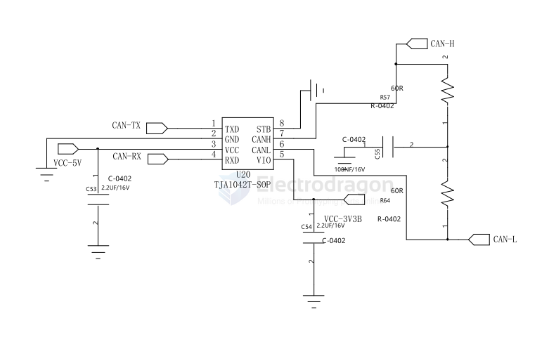

# TJA1042-dat

- [[TJA1042-dat]] - [[CAN-dat]] - [[NXP-can-dat]] - [[TJA1050-dat]]

The TJA1042 is an automotive high-speed Controller Area Network (CAN) transceiver from NXP Semiconductors that interfaces a CAN protocol controller with a two-wire CAN bus. It supports CAN and CAN FD data rates up to 5 Mbit/s and complies with ISO 11898-2 and SAE J2284 standards.

Key Features

• High-Speed & CAN FD: Operates up to 5 Mbit/s, with reduced propagation delay on TJA1042B/C variants for larger networks.
• Low-Power Standby Mode: Includes bus wake-up capability and passive bus behavior when unpowered.
• Logic-Level Compatibility: Variants with a VIO pin (such as TJA1042T/3, TJA1042TK/3, TJA1042B, and TJA1042H) interface directly with 3 V to 5 V microcontrollers.
• Automotive Protection: AEC-Q100 qualified with ±8 kV ESD protection, ±58 V bus voltage robustness, thermal and undervoltage protection, and TXD/bus-dominant time-outs.

Common Variants & Packages

• TJA1042T / TJA1042CT: Features a SPLIT pin for common-mode stabilization; backward compatible with 5 V TJA1040 designs (typically in SO8/SOP8).
• TJA1042T/3 & TJA1042TK/3: Features a VIO pin for lower-voltage MCUs; available in SO8 (T) and HVSON8 (TK) packages.
• TJA1042H: Designed for 48 V automotive systems.

## build 

## ref 

