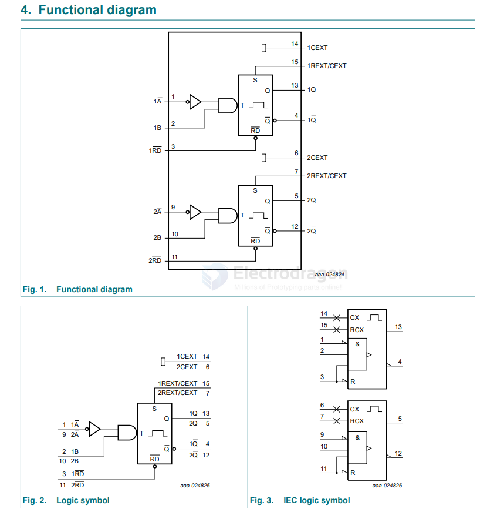
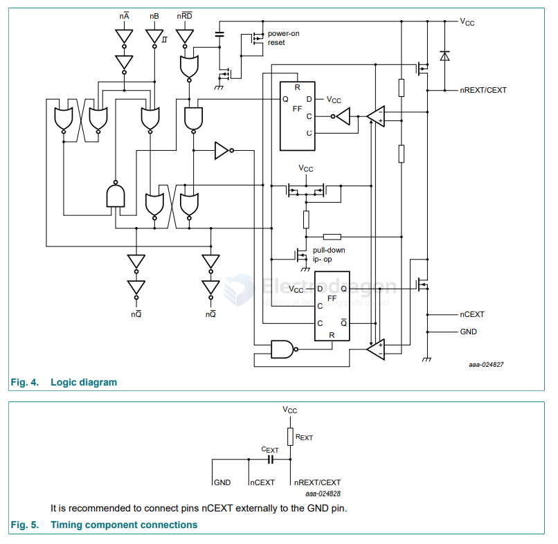

# 74HCT221-dat

- [[74HCT221-dat]] - [[NXP-logic-dat]] - [[NXP-dat]] - [[logic-dat]]

The 74HCT221 is a dual non-retriggerable monostable multivibrator. Each multivibrator features
edge-triggered inputs (nA and nB), either of which can be used as an enable input. Pulse triggering
occurs at a particular voltage level and is not directly related to the transition time of the input
pulse. Schmitt-trigger input circuitry for the nB inputs allow jitter-free triggering from inputs with
slow transition rates, providing the circuit with excellent noise immunity. Once triggered, the outputs
(nQ, nQ) are independent of further transitions of nA and nB inputs. The output pulse width is
defined by the following relationship:

tW = 0.7 × CEXTREXT

The output pulses can be terminated by the active LOW reset inputs (nRD). Pulse width stability
is achieved through internal compensation and is virtually independent of VCC and temperature.
In most applications pulse stability will only be limited by the accuracy of the external timing
components . This device features reduced input threshold levels to allow interfacing to TTL
logic levels. Inputs also include clamp diodes, this enables the use of current limiting resistors to
interface inputs to voltages in excess of VCC.

## diagram 

logic diagram 

## ref 