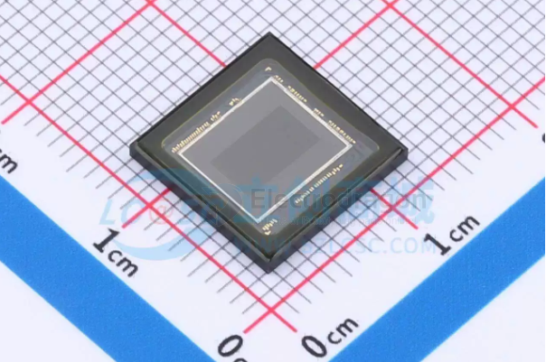

# AR0237-dat

- [[onsemi-dat]] - [[AR0237-dat]] - [[sensor-camera-dat]]

The AR0237 is a 1/2.7-inch CMOS digital image sensor with an active-pixel array of 1928 (H) x 1088 (V). It captures images in either linear or high dynamic range modes with a rolling-shutter readout, and includes sophisticated camera functions such as in-pixel binning, windowing and both video and single frame modes. 

It is designed for both low light and high dynamic range scene performance, and is programmable through a simple two-wire serial interface. 

The AR0237 produces extraordinarily clear, sharp digital pictures, and its ability to capture both continuous video and single frames makes it the perfect choice for a wide range of applications, including surveillance and HD video.

https://www.onsemi.com/products/sensors/image-sensors/ar0237

## ref 

