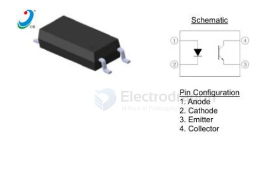

# OR1009-dat

- [[optical-coupler-dat]] - [[PC817-dat]] - [[OR1009-dat]] - [[Orient-dat]]

OR1009 (also written OR-1009) most commonly refers to either an Orient Technology 4-pin SOP phototransistor optocoupler (used for electrical isolation in electronics/appliances) or a 3-pin PTC compressor starter relay (often marked P6R8MB OR1009, used as a replacement part for refrigerators and dehumidifiers).

1. Features
(1) Current transfer ratio
(CTR: 50~600% at IF = 5mA, VCE = 5V)
(CTR: 63~320% at IF = 10mA, VCE = 5V)
(2) High input-output isolation voltage ( Viso = 5,000Vrms )
(3) High collector-emitter voltage ( VCEO = 70V )
(4) Temperature range -55 ℃ to 110 ℃
(5) Creepage distance > 8mm
(6) Employs double transfer mold technology
(7) Long Mini-flat package : 2.3mm profile :OR-10XX series

2. Description
The OR-10XX series devices consist of an infrared emitting diode, optically coupledtoaphototransistor detector.They are packaged in a 4-pin SOP package. 

3. Applications
- (1) Programmable controllers
- (2) System appliances, measuring instruments
- (3) Telecommunication equipments
- (4) Home appliances, such as fan heaters, etc. (5) Signal transmission between circuits of different potentials and impedances

## SCH 

## ref 

