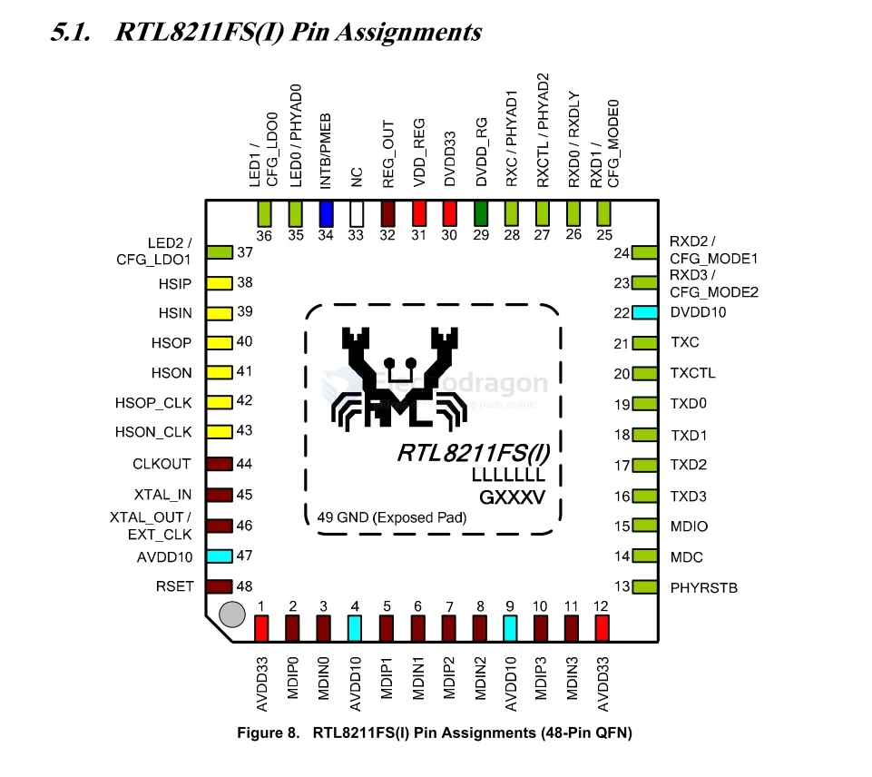
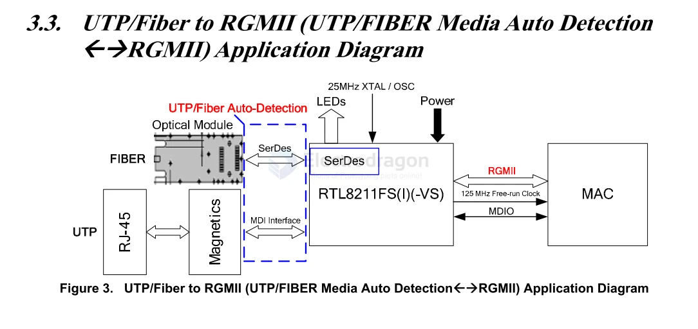
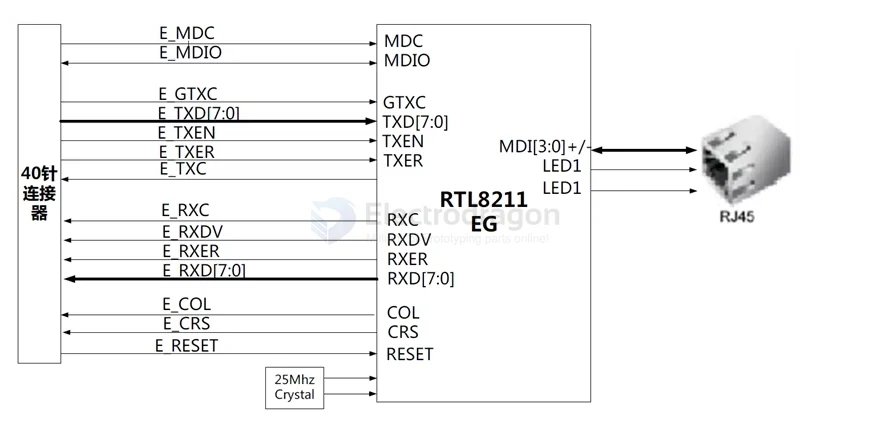
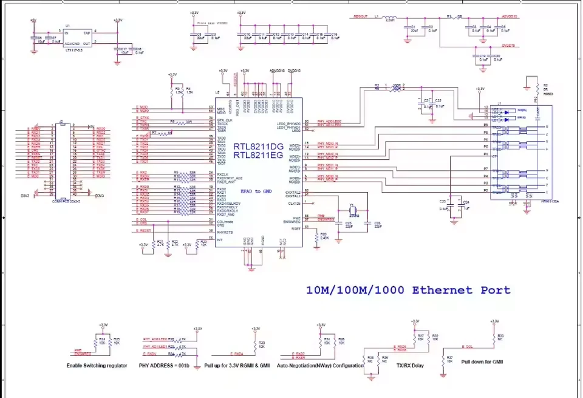
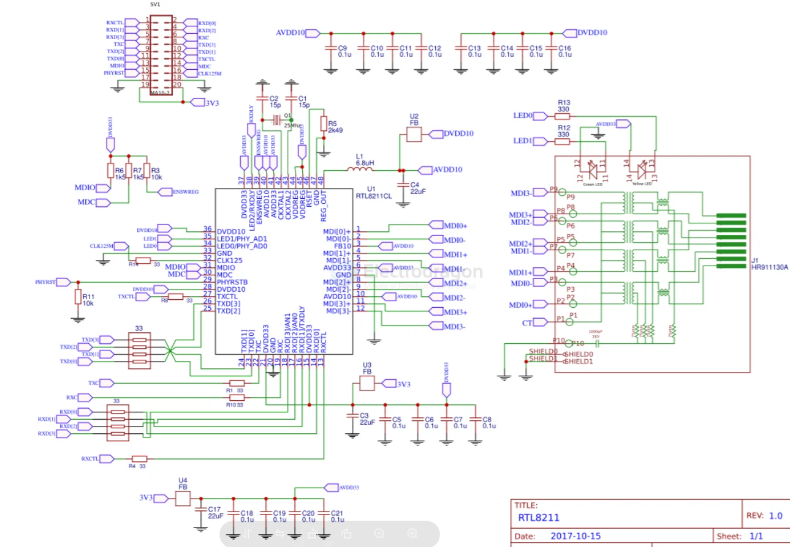
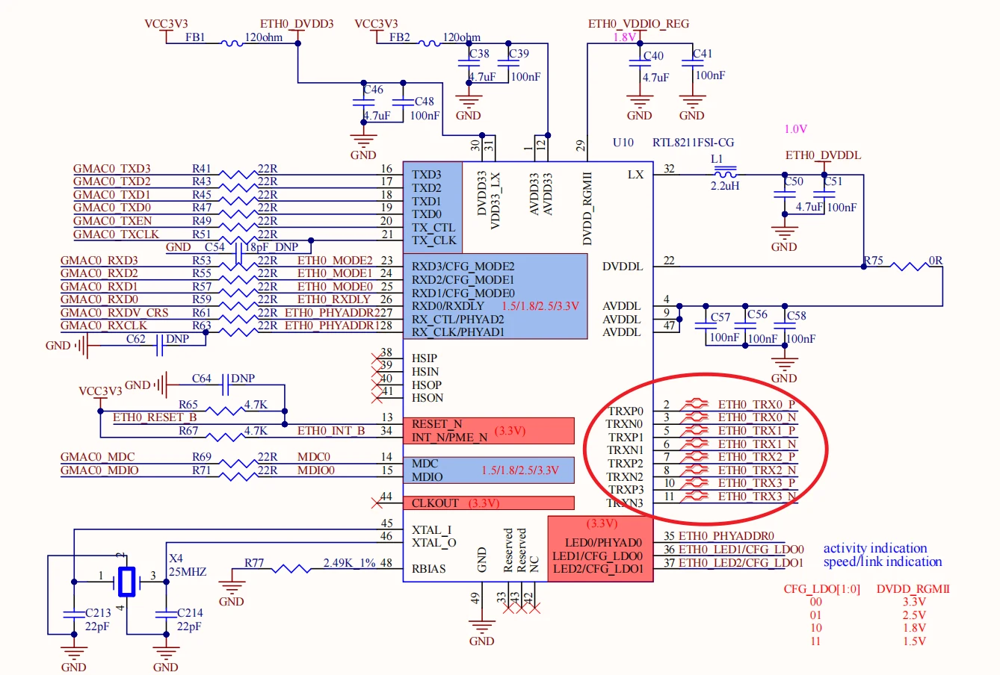

# RTL8211-dat

- [[RTL8211-dat]] - [[impedance-dat]] - [[RGMII-dat]] - [[impedance-GRMII-dat]]

- [[wifi-sdio-dat]]

[RTL8211FD(I)-CG](https://www.realtek.com/Product/Index?id=3976&cate_id=786)

## General Description

The Realtek RTL8211FD-CG/RTL8211FDI-CG is a highly integrated Ethernet transceiver that is compatible with 10Base-T, 100Base-TX, and 1000Base-T IEEE 802.3 standards. It provides all the necessary physical layer functions to transmit and receive Ethernet packets over CAT.5 UTP cable. The RTL8211FDI-CG is manufactured to industrial grade standards.

The RTL8211FD(I)-CG uses state-of-the-art DSP technology and an Analog Front End (AFE) to enable high-speed data transmission and reception over UTP cable. Functions such as Crossover Detection & Auto-Correction, polarity correction, adaptive equalization, cross-talk cancellation, echo cancellation, timing recovery, and error correction are implemented in the RTL8211FD(I)-CG to provide robust transmission and reception capabilities at 10Mbps, 100Mbps, or 1000Mbps.

Data transfer between MAC and PHY is via the Reduced Gigabit Media Independent Interface (RGMII) for 1000Base-T, 10Base-T, and 100Base-TX. The RTL8211FD(I)-CG supports various RGMII signaling voltages, including 3.3, 2.5, 1.8, and 1.5V.

- 1000Base-T
- 10Base-T
- 100Base-TX

The RTL8211FD(I)-CG incorporates a linear Low-Dropout Regulator (LDO) that features high power supply ripple rejection and low output noise. The built-in LDO means a power inductor is not required for the RTL8211FD(I)-CG; only an output capacitor is required between the 1.0V output and the analog ground for phase compensation, which saves cost and PCB real estate.

## Pin Assignments 

## Apps 

- [[fiber-optic-dat]] - [[MDI-dat]] - [[RGMII-dat]] - [[conn-RJ45-dat]] - [[PHY-dat]]

- [[network-dat]]

### Demo Board 

Gigabit ethernet phy 1000base-tx RTL8211CL

### RTL8211 with RK356x

[source info ](https://blog.csdn.net/CATTLE_L/article/details/144767114)

## guidelines 

官方RK文档描述：

>  Ethernet PHY的Reset信号需要用GPIO来控制，GPIO电平必须和PHY IO电平匹配，靠近PHY管脚必须增加100nF电容，加强抗静电能力，注意： RTL8211F/FI的复位管脚只支持3.3V电平；
>
>  RTL8211F/FI的INTB/PMEB为开漏输出，外部必须增加上拉电阻，参考图默认使用RK3568 IO内部带的上拉电阻。
>
>  PHY使用外置晶体时，晶体电容请根据实际使用的晶体的负载电容值选择，控制频偏在+/-20ppm以内；
>
>  RTL8211F/FI的RSET管脚外接电阻为2.49KΩ精度为1%，不得随意修改
>
>  MDIO必须外部加上拉电阻，推荐1.5-1.8Kohm，上拉电源必须和电源保持一致；
>
>  RTL8211F/FI的变压器中心抽头的连接必须按照参考图接，如果换其它Ethernet PHY，那么变压器中心抽头的连接，建议参考各Ethernet PHY厂家的参考设计，因为不同的PHY厂家会有不同的连接方式；
>
>  1000pF隔离电容建议采用高压安规电容，有足够大的电气间隙保证雷击的安全性；
>
>  网络变压器高压侧的75 ohm电阻建议采用0805以上的封装；
>
>  雷击防护等级达到4KV以上需要增加防雷管，普通的隔离变压器只能满足2KV等级要求；
>
>  如果有雷击差分测试要求，MDI差分对间需要增加TVS管；
>
>  务必确认RJ45封装和原理图是否一致，RJ45有分Tab down和Tab up，信号顺序刚好是相反，如果使用RTL8211F/FI建议采用Tab down，MDI顺序是顺的；
>
>  PHY的初始化硬件配置必须和实际需求匹配。
>
> 

## ref 

- [[RGMII-dat]] - [[realtek-dat]]