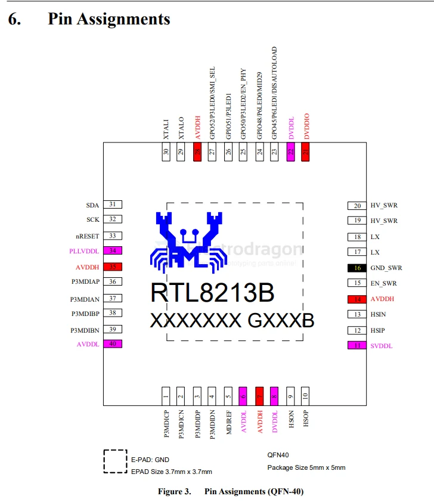
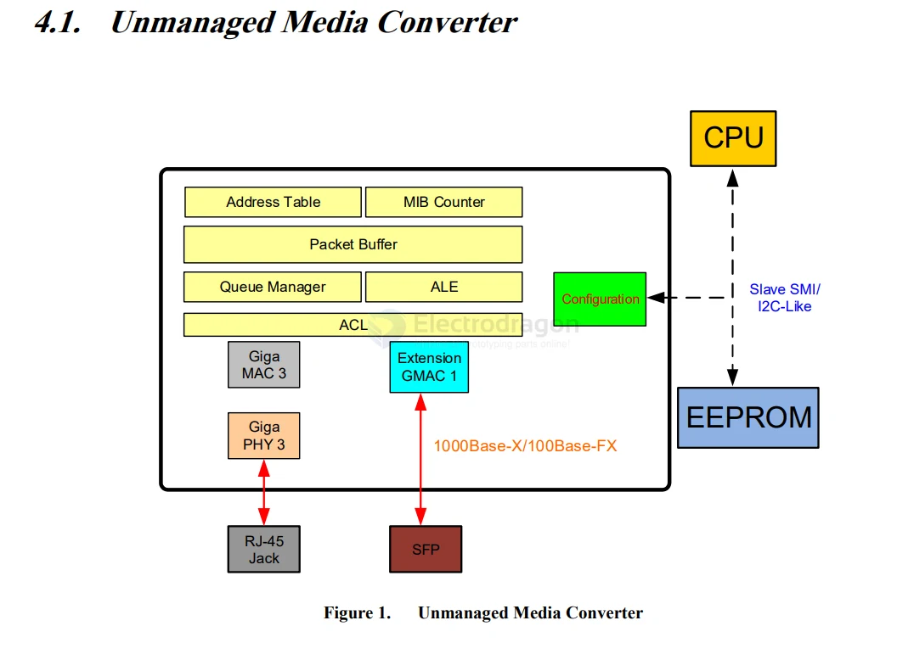
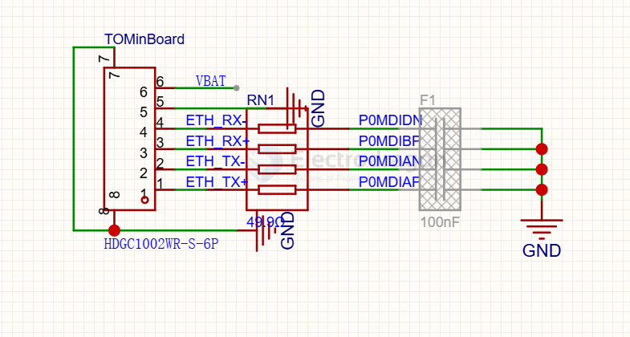
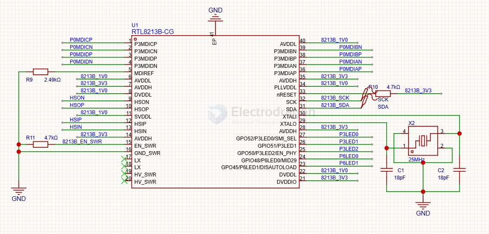
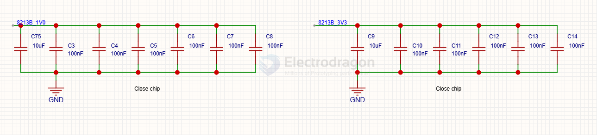
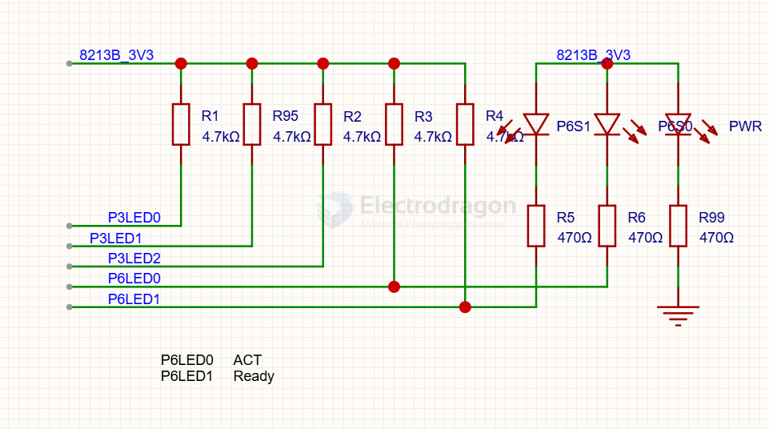
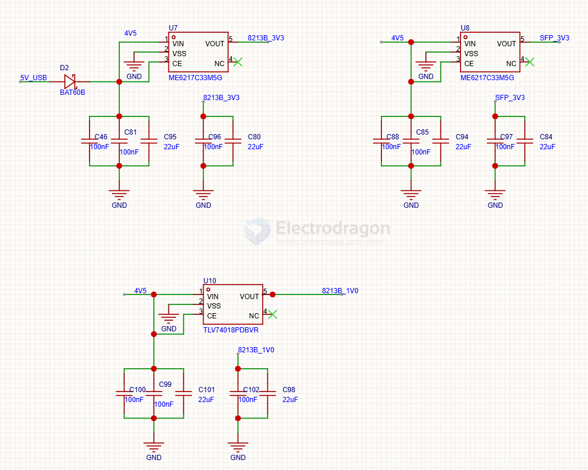
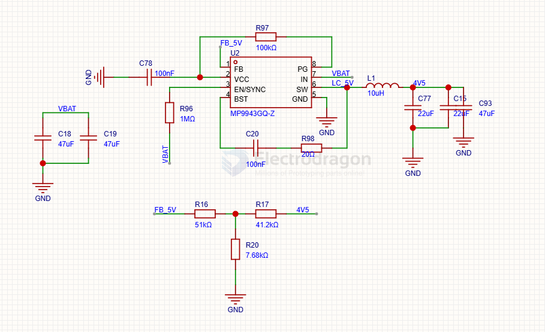
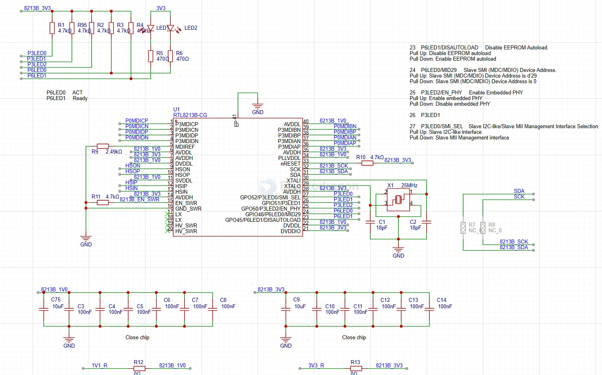

# RTL8213-dat

- [[RTL8213-dat]] - [[SFP-connector-dat]] - [[SFP-dat]] - [[realtek-dat]]

- [[1000BASE-X-dat]] - [[100BASE-FX-dat]] - [[PHY-dat]] - [[RTL8213-dat]] - [[SFP-dat]]
  
- [[RJ45-dat]] - [[ethernet-dat]]

## chip info 

## APP 

media converter 

1000 Base-X / 100 Base-FX

- [[SFP-dat]] - [[ethernet-dat]]

## SCH 

### build 2 

output 

to [[SFP-connector-dat]] - from [[RTL8213-dat]]

- [[led-dat]]

- [[TLV740-dat]] - [[LDO-dat]] - [[TI-power-LDO-dat]] - [[TI-dat]] - [[RTL8213-dat]]

- [[microne-dat]] - [[LDO-dat]] - [[ME6217-dat]] == [[SOT23-5-dat]] == 800 mA - [[RTL8213-dat]]

- [[MP9943-dat]] - [[dcdc-down-dat]] - [[RTL8213-dat]]

#### 23 P6LED1/DISAUTOLOAD

`Disable EEPROM Autoload`

Pull Up:DisableEEPROM autoload
Pull Down:EnableEEPROM autoload

#### 24 P6LED0/MID29

`SlaveSMI(MDC/MDIO) Device Address.`

Pull Up:Slave SMI (MDC/MDIO) Device Address is d'29
Pull Down:SlaveSMI (MDC/MDIO) Device Addressis 0

#### 25 P3LED2/ENPHY

`Enable Embedded PHY.`

Pull Up:Enable embeddedPHY
Pull Down:Disable embedded PHY

#### 26 P3LED1

#### 27 P3LED0/SMI_SEL 

`SlaveI2C-like/Slave MII Management Interface Selection.`

Pull Up: Slave I2C-like interface
Pull Down: Slave MII Management interface

### build 1 

## ref 

- [[realtek-dat]]