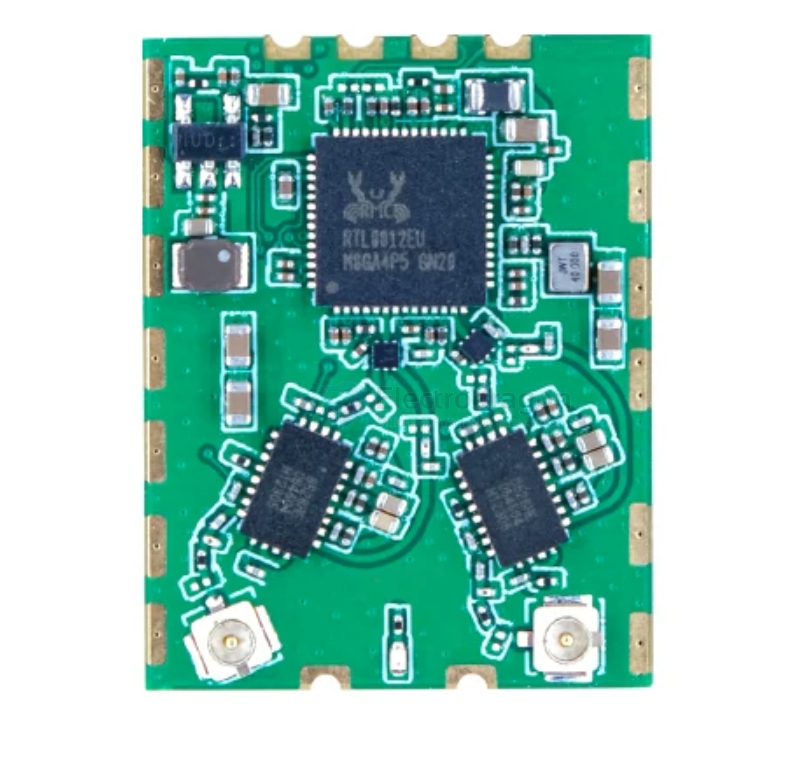

# RTL8812eu-dat

- [[realtek-dat]] - [[RTL8188-dat]]

- [[wifi-adapter-dat]] - [[RTL8812eu-dat]] - [[RTL8812-dat]] - [[RTL8812AU-dat]]

5Ghz 

RTL8812EU2 == 2.4G 

## 1. RTL8812EU (Standard Base IC)
* **Definition:** The official Realtek integrated circuit (IC) baseband/MAC/PHY model.
* **Key Features:** Supports dual-band (2.4GHz / 5GHz), 802.11ac (Wi-Fi 5), and USB 3.0 interfaces. It serves as an optimized and updated variant compared to older Realtek chipsets like the RTL8812AU.

## 2. RTL8812EU2 / EU v2 (Hardware Revision)
* **Definition:** A designation typically used by third-party wireless module manufacturers (e.g., ALFA, EDUP, or FPV custom board makers) for a **Revision 2 hardware layout**.
* **Key Features:** 
  * Indicates a board redesign—such as updated RF frontend layouts, improved Power Amplifiers (PA) / Low Noise Amplifiers (LNA), or enhanced thermal management.
  * Occasionally used in driver code trees to denote specific hardware sub-revisions.

## 3. RTL8812EUA (Package / Variant Suffix)
* **Definition:** The **"A"** suffix generally denotes a specific **package type** (e.g., physical pinout/QFN variation), **driver branch**, or **manufacturer-specific model code**.
* **Key Features:** 
  * In open-source Linux driver repositories (like those adapted for OpenIPC or custom FPV builds), developers sometimes append letters to distinguish specific USB Vendor ID / Product ID pairings or localized firmware variants.

## EU 

## build 

build 3 

build 2 

- [[RTL8812-dat]] - [[VRX-openIPC-bonnet-dat]]

build 2 

build 1 

https://oshwhub.com/cheng_jun/8812eu-25-5

## driver 

https://github.com/libc0607/rtl88x2eu-20230815

## ref 

- [[RTL8812]]