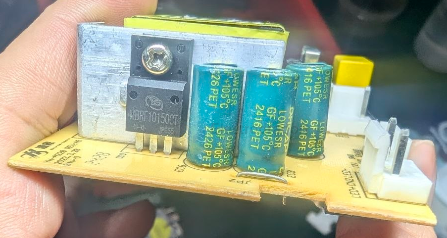

# MBRF10150-dat

- [[diode-dat]] - [[MBRF10150-dat]] - [[SMC-dat]]

MBRF10150 is a 150V, 10A Schottky barrier rectifier diode in a through-hole ITO-220AC (isolated tab / TO-220F) package.

Key Specifications (SMC Diode Solutions)

• Diode Type: Single Schottky rectifier
• Max Reverse Voltage (\(V_{R}\)): 150 V
• Average Rectified Forward Current (\(I_{F}\)): 10 A
• Max Forward Voltage (\(V_{F}\)): ~1.1 V at 10 A
• Peak Non-Repetitive Surge Current (\(I_{FSM}\)): ~138 A
• Package / Mounting: ITO-220AC (2-pin isolated full pack), through-hole (THT)
• Operating Junction Temperature: -55°C to +175°C

- [[acdc-led-driver-dat]]

## ref 

