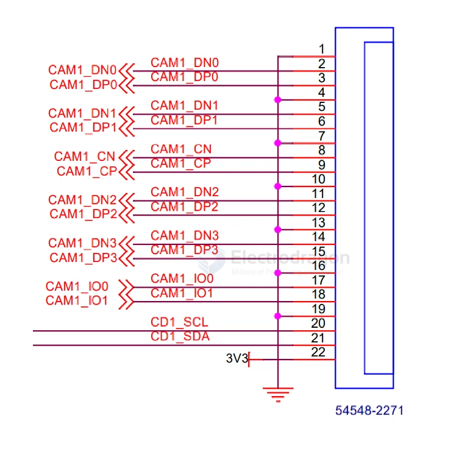

# SONY-dat

## chip

- 传感器板建议独立 4 层，MIPI 差分 + 干净电源 + 地平面

- [[IMX415-dat]] - [[IMX307-dat]] - [[sony-dat]] - [[MIPI-dat]] - [[BGA-dat]]

- [[IMX335-dat]] - [[IMX415-dat]]

- [[IMX708-dat]] - [[IMX415-dat]] - [[IMX362-dat]] - [[IMX398-dat]] 

- [[IMX378-dat]] - [[IMX219-dat]]

- [[ISX031-dat]] - [[IMX219-dat]]

- [[sony-dat]] - [[IMX415-dat]]

## tech 

- [[crystal-dat]]

- [[AVDD-dat]] - [[power-dat]]

- [[conn-DF56-dat]] - [[openIPC-dat]] - [[SSC338-dat]]

## info 

## IMX362 vs IMX398 — Parameter Comparison

### Sensor Specifications

| Parameter              | IMX362                      | IMX398              |
| ---------------------- | --------------------------- | ------------------- |
| Sensor Size            | 1/2.55" (larger)            | 1/2.8"              |
| Pixel Size             | 1.4μm (larger)              | 1.12μm              |
| Resolution             | 12 MP                       | 16 MP               |
| Autofocus              | Dual Pixel (full-pixel)     | Dual Pixel          |
| Representative Devices | Pixel 2, OPPO R11, vivo X20 | OPPO R9s / R9s Plus |

### 🎯 Core Difference: Pixel Size Determines Image Quality

The 1.4μm large pixels of the IMX362 > the 1.12μm pixels of the IMX398:

| Aspect                | IMX362 (1.4μm)               | IMX398 (1.12μm)                    |
| --------------------- | ---------------------------- | ---------------------------------- |
| Light Intake          | ✅ ~56% more light            | Less                               |
| Night Photography     | ✅ Clearly brighter & cleaner | More noise                         |
| Low-light Performance | ✅ Stronger                   | Average                            |
| Resolution            | 12 MP (sufficient)           | 16 MP (higher number, but noisier) |

**In short:** Sensor size rules — the IMX362's larger sensor + larger pixels = crushing low-light performance over the IMX398. The IMX398's only "advantage" is the 16 MP count that sounds impressive, but in practice it produces more noise and worse night shots.

### 🎯 Supporting Evidence: Real-World Device Performance

- IMX362 (Pixel 2) → DxOMark score 98, world #1 in 2017
- IMX398 (OPPO R9s Plus) → Decent photos, but far from Pixel 2's level

### Conclusion

Choose IMX362 devices (Pixel 2 / OPPO R11 / vivo X20), not the IMX398 (R9s Plus) — at the same price point, the IMX362 delivers noticeably better photos.

- [[IMX362-dat]] - [[pixel2-dat]] - [[IMX398-dat]]

## Camera 

- [[sensor-Camera-dat]]

#### camera interface 

### IMX378 

- [[IMX378-dat]]

## ref 

- [[chip-dat]]