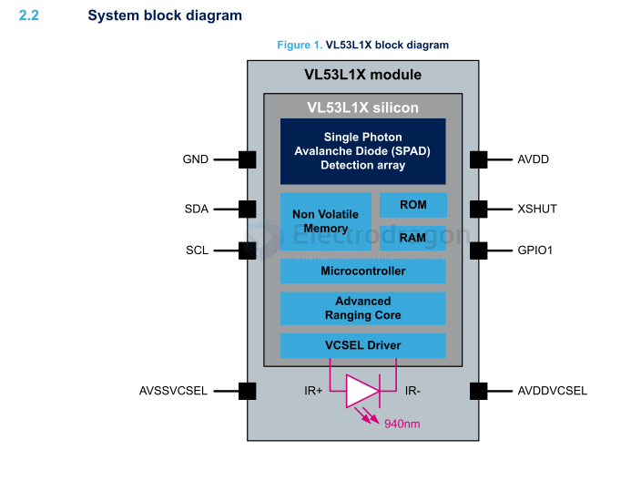

# VL53L1X-dat

- [[VL53L1X-dat]] - [[ST-sensor-dat]] - [[ST-dat]] - [[VL53L0X-dat]] - [[sensor-proximity-dat]] - [[sensor-TOF-dat]]

The VL53L1X is the newer, longer-range upgrade to the VL53L0X—both are 940 nm infrared Time-of-Flight (ToF) laser distance sensors from STMicroelectronics that share the same pinout and `0x29` I²C address, but the **VL53L1X doubles the maximum range to 4 meters** and adds an adjustable Field of View (FoV) with better ambient light resistance.

## VL53L0X vs. VL53L1X Comparison

### Key Takeaways

* **Hardware drop-in, software swap:** The breakout boards share identical wiring and I²C addresses (`0x29`), so you can swap the physical module without changing your circuit, though you must switch to a **VL53L1X firmware library**.
* **Narrower beam & multi-zone scanning:** Because the **VL53L1X** lets you shrink its 16×16 receiver array down to a **15° cone** and shift where it looks (ROI), it avoids false readings from nearby walls or the ground much better than the fixed 25° beam on the **VL53L0X**.

**Verdict:** Choose the **VL53L0X** for budget-friendly, short-range proximity or obstacle detection under **1–2 meters** indoors; choose the **VL53L1X** if you need **2–4 meters** of range (such as drone altitude hold), brighter-light tolerance, or a narrower, adjustable field of view.

## diagram 

## ref